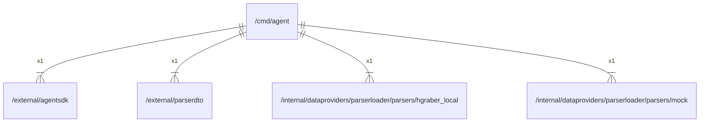

# main

## Imports

### Inner imports

| Name          | Path                                                                                                                          | Count |
|:--------------|:------------------------------------------------------------------------------------------------------------------------------|------:|
| agentsdk      | [/external/agentsdk](../external/agentsdk.md)                                                                                 |     1 |
| parserdto     | [/external/parserdto](../external/parserdto.md)                                                                               |     1 |
| hgraber_local | [/internal/dataproviders/parserloader/parsers/hgraber_local](../internal/dataproviders/parserloader/parsers/hgraber_local.md) |     1 |
| mock          | [/internal/dataproviders/parserloader/parsers/mock](../internal/dataproviders/parserloader/parsers/mock.md)                   |     1 |

## Scheme

---

> Generated by [goArchLint](https://github.com/gbh007/goarchlint)
