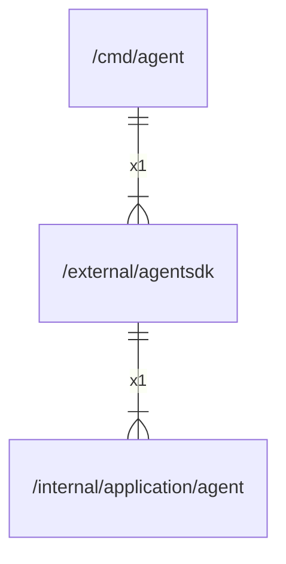

# agentsdk

## Imports

### Inner imports

| Name  | Path                                                            | Count |
|:------|:----------------------------------------------------------------|------:|
| agent | [/internal/application/agent](../internal/application/agent.md) |     1 |

## Used by

| Name  | Path                          |
|:------|:------------------------------|
| agent | [/cmd/agent](../cmd/agent.md) |

## Scheme

---

> Generated by [goArchLint](https://github.com/gbh007/goarchlint)
