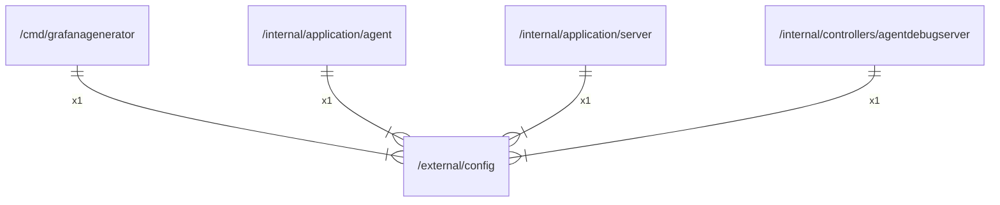

# config

## Imports

### External imports

| Name | Path                       | Count |
|:-----|:---------------------------|------:|
| toml | github.com/BurntSushi/toml |     2 |

### Std imports

| Name   | Path   | Count |
|:-------|:-------|------:|
| errors | errors |     2 |
| fmt    | fmt    |     2 |
| os     | os     |     2 |
| io     | io     |     1 |

## Used by

| Name             | Path                                                                                  |
|:-----------------|:--------------------------------------------------------------------------------------|
| grafanagenerator | [/cmd/grafanagenerator](../cmd/grafanagenerator.md)                                   |
| agent            | [/internal/application/agent](../internal/application/agent.md)                       |
| server           | [/internal/application/server](../internal/application/server.md)                     |
| agentdebugserver | [/internal/controllers/agentdebugserver](../internal/controllers/agentdebugserver.md) |

## Scheme

---

> Generated by [goArchLint](https://github.com/gbh007/goarchlint)
