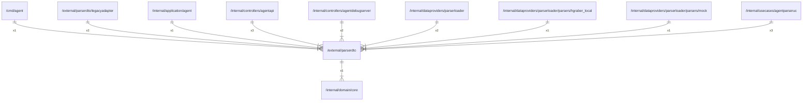

# parserdto

## Imports

### Inner imports

| Name | Path                                                | Count |
|:-----|:----------------------------------------------------|------:|
| core | [/internal/domain/core](../internal/domain/core.md) |     1 |

### Std imports

| Name    | Path     | Count |
|:--------|:---------|------:|
| url     | net/url  |     3 |
| context | context  |     2 |
| errors  | errors   |     2 |
| io      | io       |     2 |
| strings | strings  |     2 |
| html    | html     |     1 |
| http    | net/http |     1 |
| regexp  | regexp   |     1 |
| time    | time     |     1 |

## Used by

| Name             | Path                                                                                                                          |
|:-----------------|:------------------------------------------------------------------------------------------------------------------------------|
| agent            | [/cmd/agent](../cmd/agent.md)                                                                                                 |
| legacyadapter    | [/external/parserdto/legacyadapter](parserdto/legacyadapter.md)                                                               |
| agent            | [/internal/application/agent](../internal/application/agent.md)                                                               |
| agentapi         | [/internal/controllers/agentapi](../internal/controllers/agentapi.md)                                                         |
| agentdebugserver | [/internal/controllers/agentdebugserver](../internal/controllers/agentdebugserver.md)                                         |
| parserloader     | [/internal/dataproviders/parserloader](../internal/dataproviders/parserloader.md)                                             |
| hgraber_local    | [/internal/dataproviders/parserloader/parsers/hgraber_local](../internal/dataproviders/parserloader/parsers/hgraber_local.md) |
| mock             | [/internal/dataproviders/parserloader/parsers/mock](../internal/dataproviders/parserloader/parsers/mock.md)                   |
| agentparseruc    | [/internal/usecases/agentparseruc](../internal/usecases/agentparseruc.md)                                                     |

## Scheme

---

> Generated by [goArchLint](https://github.com/gbh007/goarchlint)
