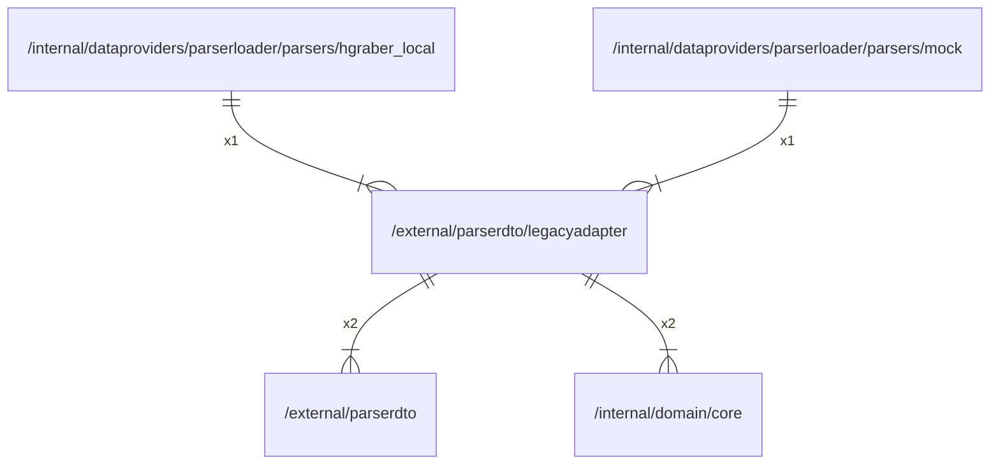

# legacyadapter

## Imports

### Inner imports

| Name      | Path                                                   | Count |
|:----------|:-------------------------------------------------------|------:|
| parserdto | [/external/parserdto](../parserdto.md)                 |     2 |
| core      | [/internal/domain/core](../../internal/domain/core.md) |     2 |

### External imports

| Name | Path                 | Count |
|:-----|:---------------------|------:|
| lo   | github.com/samber/lo |     1 |

### Std imports

| Name    | Path    | Count |
|:--------|:--------|------:|
| context | context |     2 |
| fmt     | fmt     |     1 |
| url     | net/url |     1 |

## Used by

| Name          | Path                                                                                                                             |
|:--------------|:---------------------------------------------------------------------------------------------------------------------------------|
| hgraber_local | [/internal/dataproviders/parserloader/parsers/hgraber_local](../../internal/dataproviders/parserloader/parsers/hgraber_local.md) |
| mock          | [/internal/dataproviders/parserloader/parsers/mock](../../internal/dataproviders/parserloader/parsers/mock.md)                   |

## Scheme

---

> Generated by [goArchLint](https://github.com/gbh007/goarchlint)
