# agent

## Imports

### Inner imports

| Name                      | Path                                                                                     | Count |
|:--------------------------|:-----------------------------------------------------------------------------------------|------:|
| config                    | [/external/config](../../external/config.md)                                             |     1 |
| parserdto                 | [/external/parserdto](../../external/parserdto.md)                                       |     1 |
| agnconfig                 | [/internal/application/agent/agnconfig](agent/agnconfig.md)                              |     1 |
| agentapi                  | [/internal/controllers/agentapi](../controllers/agentapi.md)                             |     1 |
| agentdebugserver          | [/internal/controllers/agentdebugserver](../controllers/agentdebugserver.md)             |     1 |
| async                     | [/internal/controllers/async](../controllers/async.md)                                   |     1 |
| agentdb                   | [/internal/dataproviders/agentdb](../dataproviders/agentdb.md)                           |     1 |
| agentimportfs             | [/internal/dataproviders/agentimportfs](../dataproviders/agentimportfs.md)               |     1 |
| agentparsecache           | [/internal/dataproviders/agentparsecache](../dataproviders/agentparsecache.md)           |     1 |
| localfs                   | [/internal/dataproviders/localfs](../dataproviders/localfs.md)                           |     1 |
| masterapi                 | [/internal/dataproviders/masterapi](../dataproviders/masterapi.md)                       |     1 |
| metric                    | [/internal/dataproviders/metric](../dataproviders/metric.md)                             |     1 |
| parserloader              | [/internal/dataproviders/parserloader](../dataproviders/parserloader.md)                 |     1 |
| request                   | [/internal/dataproviders/request](../dataproviders/request.md)                           |     1 |
| serveragentdto            | [/internal/domain/serveragentdto](../domain/serveragentdto.md)                           |     1 |
| pkg                       | [/internal/pkg](../pkg.md)                                                               |     1 |
| agenthighway              | [/internal/usecases/agenthighway](../usecases/agenthighway.md)                           |     1 |
| agentimportapiuc          | [/internal/usecases/agentimportapiuc](../usecases/agentimportapiuc.md)                   |     1 |
| agentimportdeduplicatoruc | [/internal/usecases/agentimportdeduplicatoruc](../usecases/agentimportdeduplicatoruc.md) |     1 |
| agentparseruc             | [/internal/usecases/agentparseruc](../usecases/agentparseruc.md)                         |     1 |

### Std imports

| Name    | Path      | Count |
|:--------|:----------|------:|
| slog    | log/slog  |     2 |
| os      | os        |     2 |
| context | context   |     1 |
| errors  | errors    |     1 |
| flag    | flag      |     1 |
| fmt     | fmt       |     1 |
| signal  | os/signal |     1 |
| syscall | syscall   |     1 |
| time    | time      |     1 |

## Used by

| Name     | Path                                             |
|:---------|:-------------------------------------------------|
| agentsdk | [/external/agentsdk](../../external/agentsdk.md) |

## Scheme

```mermaid
erDiagram
    "/external/agentsdk" ||--|{ "/internal/application/agent" : x1
    "/internal/application/agent" ||--|{ "/external/config" : x1
    "/internal/application/agent" ||--|{ "/external/parserdto" : x1
    "/internal/application/agent" ||--|{ "/internal/application/agent/agnconfig" : x1
    "/internal/application/agent" ||--|{ "/internal/controllers/agentapi" : x1
    "/internal/application/agent" ||--|{ "/internal/controllers/agentdebugserver" : x1
    "/internal/application/agent" ||--|{ "/internal/controllers/async" : x1
    "/internal/application/agent" ||--|{ "/internal/dataproviders/agentdb" : x1
    "/internal/application/agent" ||--|{ "/internal/dataproviders/agentimportfs" : x1
    "/internal/application/agent" ||--|{ "/internal/dataproviders/agentparsecache" : x1
    "/internal/application/agent" ||--|{ "/internal/dataproviders/localfs" : x1
    "/internal/application/agent" ||--|{ "/internal/dataproviders/masterapi" : x1
    "/internal/application/agent" ||--|{ "/internal/dataproviders/metric" : x1
    "/internal/application/agent" ||--|{ "/internal/dataproviders/parserloader" : x1
    "/internal/application/agent" ||--|{ "/internal/dataproviders/request" : x1
    "/internal/application/agent" ||--|{ "/internal/domain/serveragentdto" : x1
    "/internal/application/agent" ||--|{ "/internal/pkg" : x1
    "/internal/application/agent" ||--|{ "/internal/usecases/agenthighway" : x1
    "/internal/application/agent" ||--|{ "/internal/usecases/agentimportapiuc" : x1
    "/internal/application/agent" ||--|{ "/internal/usecases/agentimportdeduplicatoruc" : x1
    "/internal/application/agent" ||--|{ "/internal/usecases/agentparseruc" : x1
```

---

> Generated by [goArchLint](https://github.com/gbh007/goarchlint)
