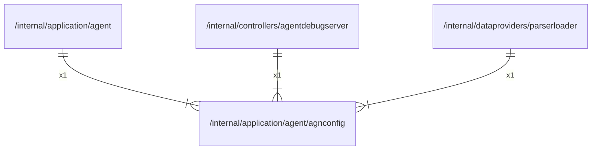

# agnconfig

## Imports

### Std imports

| Name    | Path     | Count |
|:--------|:---------|------:|
| time    | time     |     3 |
| slog    | log/slog |     1 |
| strings | strings  |     1 |

## Used by

| Name             | Path                                                                            |
|:-----------------|:--------------------------------------------------------------------------------|
| agent            | [/internal/application/agent](../agent.md)                                      |
| agentdebugserver | [/internal/controllers/agentdebugserver](../../controllers/agentdebugserver.md) |
| parserloader     | [/internal/dataproviders/parserloader](../../dataproviders/parserloader.md)     |

## Scheme

---

> Generated by [goArchLint](https://github.com/gbh007/goarchlint)
