# server

## Imports

### Inner imports

| Name                | Path                                                                         | Count |
|:--------------------|:-----------------------------------------------------------------------------|------:|
| srvconfig           | [/internal/application/server/srvconfig](server/srvconfig.md)                |     3 |
| workermanager       | [/internal/controllers/workermanager](../controllers/workermanager.md)       |     3 |
| async               | [/internal/controllers/async](../controllers/async.md)                       |     2 |
| agentapi            | [/internal/dataproviders/agentapi](../dataproviders/agentapi.md)             |     2 |
| filestorage         | [/internal/dataproviders/filestorage](../dataproviders/filestorage.md)       |     2 |
| metric              | [/internal/dataproviders/metric](../dataproviders/metric.md)                 |     2 |
| serverdb            | [/internal/dataproviders/serverdb](../dataproviders/serverdb.md)             |     2 |
| tmpdata             | [/internal/dataproviders/tmpdata](../dataproviders/tmpdata.md)               |     2 |
| agentmanagesuc      | [/internal/usecases/agentmanagesuc](../usecases/agentmanagesuc.md)           |     2 |
| attributeusecase    | [/internal/usecases/attributeusecase](../usecases/attributeusecase.md)       |     2 |
| bffusecase          | [/internal/usecases/bffusecase](../usecases/bffusecase.md)                   |     2 |
| bookusecase         | [/internal/usecases/bookusecase](../usecases/bookusecase.md)                 |     2 |
| cleanupusecase      | [/internal/usecases/cleanupusecase](../usecases/cleanupusecase.md)           |     2 |
| deduplicatorusecase | [/internal/usecases/deduplicatorusecase](../usecases/deduplicatorusecase.md) |     2 |
| exportusecase       | [/internal/usecases/exportusecase](../usecases/exportusecase.md)             |     2 |
| filesystemusecase   | [/internal/usecases/filesystemusecase](../usecases/filesystemusecase.md)     |     2 |
| hproxyusecase       | [/internal/usecases/hproxyusecase](../usecases/hproxyusecase.md)             |     2 |
| labelusecase        | [/internal/usecases/labelusecase](../usecases/labelusecase.md)               |     2 |
| massloadusecase     | [/internal/usecases/massloadusecase](../usecases/massloadusecase.md)         |     2 |
| parsingusecase      | [/internal/usecases/parsingusecase](../usecases/parsingusecase.md)           |     2 |
| rebuilderusecase    | [/internal/usecases/rebuilderusecase](../usecases/rebuilderusecase.md)       |     2 |
| systemusecase       | [/internal/usecases/systemusecase](../usecases/systemusecase.md)             |     2 |
| config              | [/external/config](../../external/config.md)                                 |     1 |
| agentcacheapi       | [/internal/controllers/agentcacheapi](../controllers/agentcacheapi.md)       |     1 |
| serverapi           | [/internal/controllers/serverapi](../controllers/serverapi.md)               |     1 |
| core                | [/internal/domain/core](../domain/core.md)                                   |     1 |
| systemmodel         | [/internal/domain/systemmodel](../domain/systemmodel.md)                     |     1 |
| mcp                 | [/internal/experimental/mcp](../experimental/mcp.md)                         |     1 |

### Std imports

| Name    | Path     | Count |
|:--------|:---------|------:|
| context | context  |     4 |
| fmt     | fmt      |     4 |
| slog    | log/slog |     3 |
| os      | os       |     2 |
| flag    | flag     |     1 |
| time    | time     |     1 |

## Used by

| Name   | Path                               |
|:-------|:-----------------------------------|
| server | [/cmd/server](../../cmd/server.md) |

## Scheme

```mermaid
erDiagram
    "/cmd/server" ||--|{ "/internal/application/server" : x1
    "/internal/application/server" ||--|{ "/external/config" : x1
    "/internal/application/server" ||--|{ "/internal/application/server/srvconfig" : x3
    "/internal/application/server" ||--|{ "/internal/controllers/agentcacheapi" : x1
    "/internal/application/server" ||--|{ "/internal/controllers/async" : x2
    "/internal/application/server" ||--|{ "/internal/controllers/serverapi" : x1
    "/internal/application/server" ||--|{ "/internal/controllers/workermanager" : x3
    "/internal/application/server" ||--|{ "/internal/dataproviders/agentapi" : x2
    "/internal/application/server" ||--|{ "/internal/dataproviders/filestorage" : x2
    "/internal/application/server" ||--|{ "/internal/dataproviders/metric" : x2
    "/internal/application/server" ||--|{ "/internal/dataproviders/serverdb" : x2
    "/internal/application/server" ||--|{ "/internal/dataproviders/tmpdata" : x2
    "/internal/application/server" ||--|{ "/internal/domain/core" : x1
    "/internal/application/server" ||--|{ "/internal/domain/systemmodel" : x1
    "/internal/application/server" ||--|{ "/internal/experimental/mcp" : x1
    "/internal/application/server" ||--|{ "/internal/usecases/agentmanagesuc" : x2
    "/internal/application/server" ||--|{ "/internal/usecases/attributeusecase" : x2
    "/internal/application/server" ||--|{ "/internal/usecases/bffusecase" : x2
    "/internal/application/server" ||--|{ "/internal/usecases/bookusecase" : x2
    "/internal/application/server" ||--|{ "/internal/usecases/cleanupusecase" : x2
    "/internal/application/server" ||--|{ "/internal/usecases/deduplicatorusecase" : x2
    "/internal/application/server" ||--|{ "/internal/usecases/exportusecase" : x2
    "/internal/application/server" ||--|{ "/internal/usecases/filesystemusecase" : x2
    "/internal/application/server" ||--|{ "/internal/usecases/hproxyusecase" : x2
    "/internal/application/server" ||--|{ "/internal/usecases/labelusecase" : x2
    "/internal/application/server" ||--|{ "/internal/usecases/massloadusecase" : x2
    "/internal/application/server" ||--|{ "/internal/usecases/parsingusecase" : x2
    "/internal/application/server" ||--|{ "/internal/usecases/rebuilderusecase" : x2
    "/internal/application/server" ||--|{ "/internal/usecases/systemusecase" : x2
```

---

> Generated by [goArchLint](https://github.com/gbh007/goarchlint)
