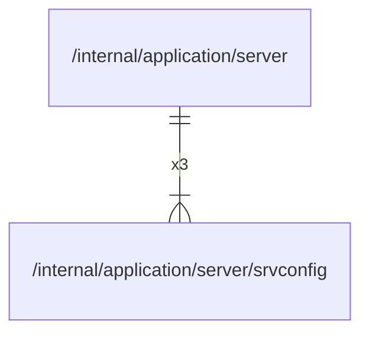

# srvconfig

## Imports

### Std imports

| Name    | Path     | Count |
|:--------|:---------|------:|
| time    | time     |     4 |
| slog    | log/slog |     1 |
| strings | strings  |     1 |

## Used by

| Name   | Path                                         |
|:-------|:---------------------------------------------|
| server | [/internal/application/server](../server.md) |

## Scheme

---

> Generated by [goArchLint](https://github.com/gbh007/goarchlint)
