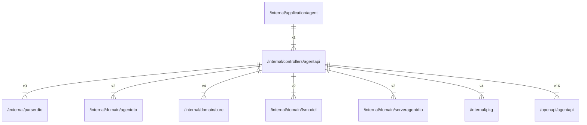

# agentapi

## Imports

### Inner imports

| Name           | Path                                                           | Count |
|:---------------|:---------------------------------------------------------------|------:|
| agentapi       | [/openapi/agentapi](../../openapi/agentapi.md)                 |    16 |
| core           | [/internal/domain/core](../domain/core.md)                     |     4 |
| pkg            | [/internal/pkg](../pkg.md)                                     |     4 |
| parserdto      | [/external/parserdto](../../external/parserdto.md)             |     3 |
| agentdto       | [/internal/domain/agentdto](../domain/agentdto.md)             |     2 |
| fsmodel        | [/internal/domain/fsmodel](../domain/fsmodel.md)               |     2 |
| serveragentdto | [/internal/domain/serveragentdto](../domain/serveragentdto.md) |     2 |

### External imports

| Name       | Path                                                    | Count |
|:-----------|:--------------------------------------------------------|------:|
| ogenerrors | github.com/ogen-go/ogen/ogenerrors                      |     2 |
| validate   | github.com/ogen-go/ogen/validate                        |     2 |
| uuid       | github.com/google/uuid                                  |     1 |
| middleware | github.com/ogen-go/ogen/middleware                      |     1 |
| prometheus | github.com/prometheus/client_golang/prometheus          |     1 |
| promhttp   | github.com/prometheus/client_golang/prometheus/promhttp |     1 |

### Std imports

| Name    | Path          | Count |
|:--------|:--------------|------:|
| context | context       |    16 |
| http    | net/http      |    15 |
| errors  | errors        |     8 |
| slog    | log/slog      |     4 |
| url     | net/url       |     3 |
| time    | time          |     3 |
| io      | io            |     2 |
| strconv | strconv       |     2 |
| strings | strings       |     2 |
| bytes   | bytes         |     1 |
| json    | encoding/json |     1 |
| fmt     | fmt           |     1 |
| mime    | mime          |     1 |
| runtime | runtime       |     1 |

## Used by

| Name  | Path                                                   |
|:------|:-------------------------------------------------------|
| agent | [/internal/application/agent](../application/agent.md) |

## Scheme

---

> Generated by [goArchLint](https://github.com/gbh007/goarchlint)
