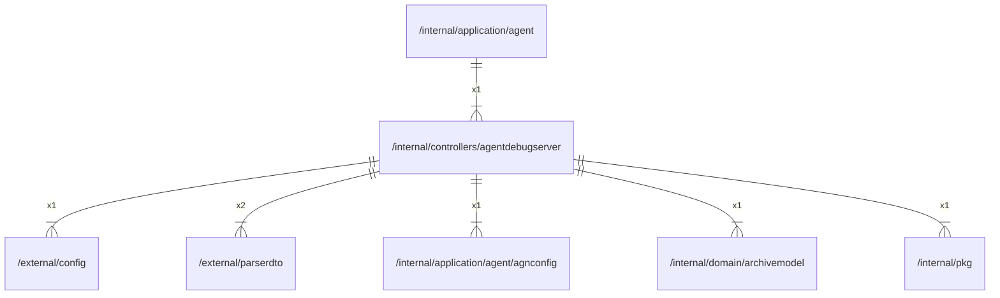

# agentdebugserver

## Imports

### Inner imports

| Name         | Path                                                                       | Count |
|:-------------|:---------------------------------------------------------------------------|------:|
| parserdto    | [/external/parserdto](../../external/parserdto.md)                         |     2 |
| config       | [/external/config](../../external/config.md)                               |     1 |
| agnconfig    | [/internal/application/agent/agnconfig](../application/agent/agnconfig.md) |     1 |
| archivemodel | [/internal/domain/archivemodel](../domain/archivemodel.md)                 |     1 |
| pkg          | [/internal/pkg](../pkg.md)                                                 |     1 |

### External imports

| Name       | Path                                   | Count |
|:-----------|:---------------------------------------|------:|
| v4         | github.com/labstack/echo/v4            |     5 |
| middleware | github.com/labstack/echo/v4/middleware |     1 |
| lo         | github.com/samber/lo                   |     1 |

### Std imports

| Name     | Path          | Count |
|:---------|:--------------|------:|
| http     | net/http      |     4 |
| context  | context       |     3 |
| io       | io            |     3 |
| bytes    | bytes         |     2 |
| errors   | errors        |     2 |
| template | html/template |     2 |
| slog     | log/slog      |     2 |
| url      | net/url       |     2 |
| time     | time          |     2 |
| zip      | archive/zip   |     1 |
| embed    | embed         |     1 |
| json     | encoding/json |     1 |
| fmt      | fmt           |     1 |
| path     | path          |     1 |

## Used by

| Name  | Path                                                   |
|:------|:-------------------------------------------------------|
| agent | [/internal/application/agent](../application/agent.md) |

## Scheme

---

> Generated by [goArchLint](https://github.com/gbh007/goarchlint)
