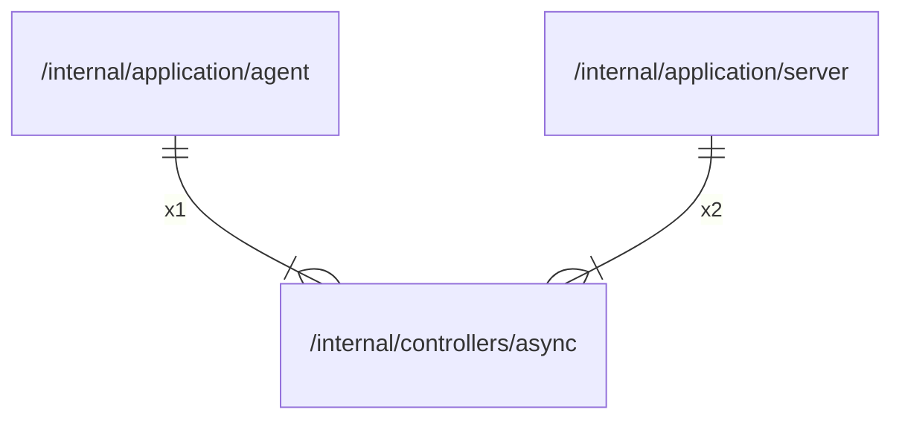

# async

## Imports

### Std imports

| Name    | Path     | Count |
|:--------|:---------|------:|
| context | context  |     1 |
| fmt     | fmt      |     1 |
| slog    | log/slog |     1 |

## Used by

| Name   | Path                                                     |
|:-------|:---------------------------------------------------------|
| agent  | [/internal/application/agent](../application/agent.md)   |
| server | [/internal/application/server](../application/server.md) |

## Scheme

---

> Generated by [goArchLint](https://github.com/gbh007/goarchlint)
