# serverapi

## Imports

### Inner imports

| Name                | Path                                                                                    | Count |
|:--------------------|:----------------------------------------------------------------------------------------|------:|
| serverapi           | [/openapi/serverapi](../../openapi/serverapi.md)                                        |     4 |
| apiservercore       | [/internal/controllers/serverapi/apiservercore](serverapi/apiservercore.md)             |     3 |
| agenthandlers       | [/internal/controllers/serverapi/agenthandlers](serverapi/agenthandlers.md)             |     1 |
| attributehandlers   | [/internal/controllers/serverapi/attributehandlers](serverapi/attributehandlers.md)     |     1 |
| bookhandlers        | [/internal/controllers/serverapi/bookhandlers](serverapi/bookhandlers.md)               |     1 |
| deduplicatehandlers | [/internal/controllers/serverapi/deduplicatehandlers](serverapi/deduplicatehandlers.md) |     1 |
| fshandlers          | [/internal/controllers/serverapi/fshandlers](serverapi/fshandlers.md)                   |     1 |
| hproxyhandlers      | [/internal/controllers/serverapi/hproxyhandlers](serverapi/hproxyhandlers.md)           |     1 |
| labelhandlers       | [/internal/controllers/serverapi/labelhandlers](serverapi/labelhandlers.md)             |     1 |
| massloadhandlers    | [/internal/controllers/serverapi/massloadhandlers](serverapi/massloadhandlers.md)       |     1 |
| systemhandlers      | [/internal/controllers/serverapi/systemhandlers](serverapi/systemhandlers.md)           |     1 |

### External imports

| Name       | Path                                                    | Count |
|:-----------|:--------------------------------------------------------|------:|
| ogenerrors | github.com/ogen-go/ogen/ogenerrors                      |     2 |
| validate   | github.com/ogen-go/ogen/validate                        |     2 |
| middleware | github.com/ogen-go/ogen/middleware                      |     1 |
| prometheus | github.com/prometheus/client_golang/prometheus          |     1 |
| promhttp   | github.com/prometheus/client_golang/prometheus/promhttp |     1 |

### Std imports

| Name    | Path          | Count |
|:--------|:--------------|------:|
| http    | net/http      |     6 |
| context | context       |     4 |
| errors  | errors        |     4 |
| slog    | log/slog      |     4 |
| time    | time          |     3 |
| bytes   | bytes         |     2 |
| fmt     | fmt           |     2 |
| strings | strings       |     2 |
| json    | encoding/json |     1 |
| io      | io            |     1 |
| runtime | runtime       |     1 |
| strconv | strconv       |     1 |

## Used by

| Name   | Path                                                     |
|:-------|:---------------------------------------------------------|
| server | [/internal/application/server](../application/server.md) |

## Scheme

```mermaid
erDiagram
    "/internal/application/server" ||--|{ "/internal/controllers/serverapi" : x1
    "/internal/controllers/serverapi" ||--|{ "/internal/controllers/serverapi/agenthandlers" : x1
    "/internal/controllers/serverapi" ||--|{ "/internal/controllers/serverapi/apiservercore" : x3
    "/internal/controllers/serverapi" ||--|{ "/internal/controllers/serverapi/attributehandlers" : x1
    "/internal/controllers/serverapi" ||--|{ "/internal/controllers/serverapi/bookhandlers" : x1
    "/internal/controllers/serverapi" ||--|{ "/internal/controllers/serverapi/deduplicatehandlers" : x1
    "/internal/controllers/serverapi" ||--|{ "/internal/controllers/serverapi/fshandlers" : x1
    "/internal/controllers/serverapi" ||--|{ "/internal/controllers/serverapi/hproxyhandlers" : x1
    "/internal/controllers/serverapi" ||--|{ "/internal/controllers/serverapi/labelhandlers" : x1
    "/internal/controllers/serverapi" ||--|{ "/internal/controllers/serverapi/massloadhandlers" : x1
    "/internal/controllers/serverapi" ||--|{ "/internal/controllers/serverapi/systemhandlers" : x1
    "/internal/controllers/serverapi" ||--|{ "/openapi/serverapi" : x4
```

---

> Generated by [goArchLint](https://github.com/gbh007/goarchlint)
