# apiservercore

## Imports

### Inner imports

| Name      | Path                                                | Count |
|:----------|:----------------------------------------------------|------:|
| serverapi | [/openapi/serverapi](../../../openapi/serverapi.md) |     3 |
| core      | [/internal/domain/core](../../domain/core.md)       |     2 |
| bff       | [/internal/domain/bff](../../domain/bff.md)         |     1 |
| fsmodel   | [/internal/domain/fsmodel](../../domain/fsmodel.md) |     1 |
| pkg       | [/internal/pkg](../../pkg.md)                       |     1 |

### External imports

| Name | Path                   | Count |
|:-----|:-----------------------|------:|
| uuid | github.com/google/uuid |     3 |

### Std imports

| Name    | Path     | Count |
|:--------|:---------|------:|
| context | context  |     3 |
| url     | net/url  |     3 |
| slog    | log/slog |     2 |
| time    | time     |     2 |
| fmt     | fmt      |     1 |
| strconv | strconv  |     1 |

## Used by

| Name                | Path                                                                          |
|:--------------------|:------------------------------------------------------------------------------|
| serverapi           | [/internal/controllers/serverapi](../serverapi.md)                            |
| agenthandlers       | [/internal/controllers/serverapi/agenthandlers](agenthandlers.md)             |
| attributehandlers   | [/internal/controllers/serverapi/attributehandlers](attributehandlers.md)     |
| bookhandlers        | [/internal/controllers/serverapi/bookhandlers](bookhandlers.md)               |
| deduplicatehandlers | [/internal/controllers/serverapi/deduplicatehandlers](deduplicatehandlers.md) |
| fshandlers          | [/internal/controllers/serverapi/fshandlers](fshandlers.md)                   |
| hproxyhandlers      | [/internal/controllers/serverapi/hproxyhandlers](hproxyhandlers.md)           |
| labelhandlers       | [/internal/controllers/serverapi/labelhandlers](labelhandlers.md)             |
| massloadhandlers    | [/internal/controllers/serverapi/massloadhandlers](massloadhandlers.md)       |
| systemhandlers      | [/internal/controllers/serverapi/systemhandlers](systemhandlers.md)           |

## Scheme

```mermaid
erDiagram
    "/internal/controllers/serverapi" ||--|{ "/internal/controllers/serverapi/apiservercore" : x3
    "/internal/controllers/serverapi/agenthandlers" ||--|{ "/internal/controllers/serverapi/apiservercore" : x5
    "/internal/controllers/serverapi/apiservercore" ||--|{ "/internal/domain/bff" : x1
    "/internal/controllers/serverapi/apiservercore" ||--|{ "/internal/domain/core" : x2
    "/internal/controllers/serverapi/apiservercore" ||--|{ "/internal/domain/fsmodel" : x1
    "/internal/controllers/serverapi/apiservercore" ||--|{ "/internal/pkg" : x1
    "/internal/controllers/serverapi/apiservercore" ||--|{ "/openapi/serverapi" : x3
    "/internal/controllers/serverapi/attributehandlers" ||--|{ "/internal/controllers/serverapi/apiservercore" : x5
    "/internal/controllers/serverapi/bookhandlers" ||--|{ "/internal/controllers/serverapi/apiservercore" : x10
    "/internal/controllers/serverapi/deduplicatehandlers" ||--|{ "/internal/controllers/serverapi/apiservercore" : x3
    "/internal/controllers/serverapi/fshandlers" ||--|{ "/internal/controllers/serverapi/apiservercore" : x7
    "/internal/controllers/serverapi/hproxyhandlers" ||--|{ "/internal/controllers/serverapi/apiservercore" : x3
    "/internal/controllers/serverapi/labelhandlers" ||--|{ "/internal/controllers/serverapi/apiservercore" : x3
    "/internal/controllers/serverapi/massloadhandlers" ||--|{ "/internal/controllers/serverapi/apiservercore" : x4
    "/internal/controllers/serverapi/systemhandlers" ||--|{ "/internal/controllers/serverapi/apiservercore" : x5
```

---

> Generated by [goArchLint](https://github.com/gbh007/goarchlint)
