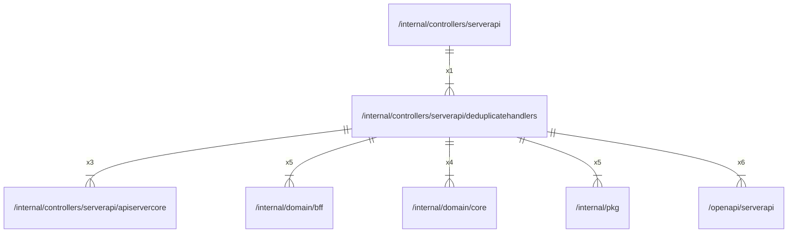

# deduplicatehandlers

## Imports

### Inner imports

| Name          | Path                                                              | Count |
|:--------------|:------------------------------------------------------------------|------:|
| serverapi     | [/openapi/serverapi](../../../openapi/serverapi.md)               |     6 |
| bff           | [/internal/domain/bff](../../domain/bff.md)                       |     5 |
| pkg           | [/internal/pkg](../../pkg.md)                                     |     5 |
| core          | [/internal/domain/core](../../domain/core.md)                     |     4 |
| apiservercore | [/internal/controllers/serverapi/apiservercore](apiservercore.md) |     3 |

### External imports

| Name | Path                   | Count |
|:-----|:-----------------------|------:|
| uuid | github.com/google/uuid |     1 |

### Std imports

| Name    | Path     | Count |
|:--------|:---------|------:|
| context | context  |     7 |
| io      | io       |     1 |
| slog    | log/slog |     1 |

## Used by

| Name      | Path                                               |
|:----------|:---------------------------------------------------|
| serverapi | [/internal/controllers/serverapi](../serverapi.md) |

## Scheme

---

> Generated by [goArchLint](https://github.com/gbh007/goarchlint)
