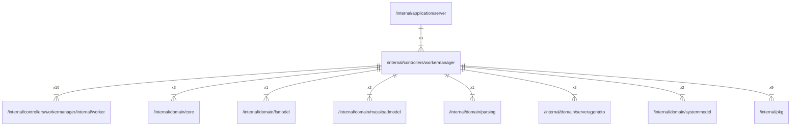

# workermanager

## Imports

### Inner imports

| Name           | Path                                                                                    | Count |
|:---------------|:----------------------------------------------------------------------------------------|------:|
| worker         | [/internal/controllers/workermanager/internal/worker](workermanager/internal/worker.md) |    10 |
| pkg            | [/internal/pkg](../pkg.md)                                                              |     9 |
| core           | [/internal/domain/core](../domain/core.md)                                              |     3 |
| massloadmodel  | [/internal/domain/massloadmodel](../domain/massloadmodel.md)                            |     2 |
| serveragentdto | [/internal/domain/serveragentdto](../domain/serveragentdto.md)                          |     2 |
| systemmodel    | [/internal/domain/systemmodel](../domain/systemmodel.md)                                |     2 |
| fsmodel        | [/internal/domain/fsmodel](../domain/fsmodel.md)                                        |     1 |
| parsing        | [/internal/domain/parsing](../domain/parsing.md)                                        |     1 |

### External imports

| Name | Path                   | Count |
|:-----|:-----------------------|------:|
| uuid | github.com/google/uuid |     4 |

### Std imports

| Name    | Path     | Count |
|:--------|:---------|------:|
| context | context  |    11 |
| slog    | log/slog |    11 |
| sync    | sync     |     1 |
| time    | time     |     1 |

## Used by

| Name   | Path                                                     |
|:-------|:---------------------------------------------------------|
| server | [/internal/application/server](../application/server.md) |

## Scheme

---

> Generated by [goArchLint](https://github.com/gbh007/goarchlint)
