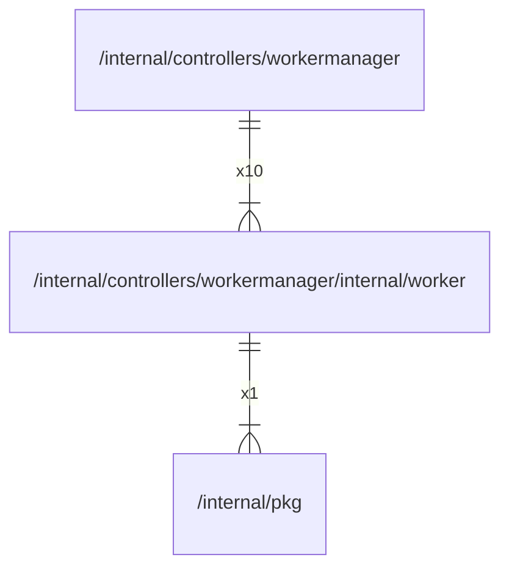

# worker

## Imports

### Inner imports

| Name | Path                             | Count |
|:-----|:---------------------------------|------:|
| pkg  | [/internal/pkg](../../../pkg.md) |     1 |

### Std imports

| Name    | Path        | Count |
|:--------|:------------|------:|
| context | context     |     2 |
| slog    | log/slog    |     2 |
| sync    | sync        |     2 |
| time    | time        |     2 |
| fmt     | fmt         |     1 |
| runtime | runtime     |     1 |
| strconv | strconv     |     1 |
| atomic  | sync/atomic |     1 |

## Used by

| Name          | Path                                                          |
|:--------------|:--------------------------------------------------------------|
| workermanager | [/internal/controllers/workermanager](../../workermanager.md) |

## Scheme

---

> Generated by [goArchLint](https://github.com/gbh007/goarchlint)
