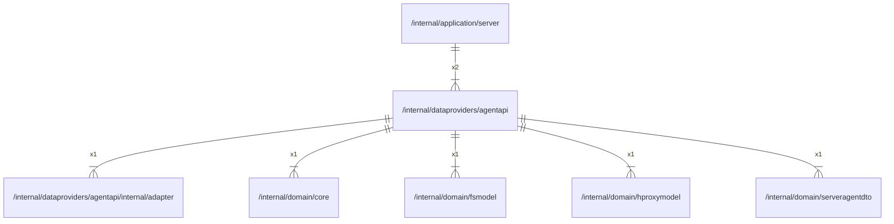

# agentapi

## Imports

### Inner imports

| Name           | Path                                                                              | Count |
|:---------------|:----------------------------------------------------------------------------------|------:|
| adapter        | [/internal/dataproviders/agentapi/internal/adapter](agentapi/internal/adapter.md) |     1 |
| core           | [/internal/domain/core](../domain/core.md)                                        |     1 |
| fsmodel        | [/internal/domain/fsmodel](../domain/fsmodel.md)                                  |     1 |
| hproxymodel    | [/internal/domain/hproxymodel](../domain/hproxymodel.md)                          |     1 |
| serveragentdto | [/internal/domain/serveragentdto](../domain/serveragentdto.md)                    |     1 |

### External imports

| Name | Path                   | Count |
|:-----|:-----------------------|------:|
| uuid | github.com/google/uuid |     3 |

### Std imports

| Name    | Path    | Count |
|:--------|:--------|------:|
| context | context |     2 |
| io      | io      |     2 |
| time    | time    |     2 |
| fmt     | fmt     |     1 |
| url     | net/url |     1 |
| sync    | sync    |     1 |

## Used by

| Name   | Path                                                     |
|:-------|:---------------------------------------------------------|
| server | [/internal/application/server](../application/server.md) |

## Scheme

---

> Generated by [goArchLint](https://github.com/gbh007/goarchlint)
