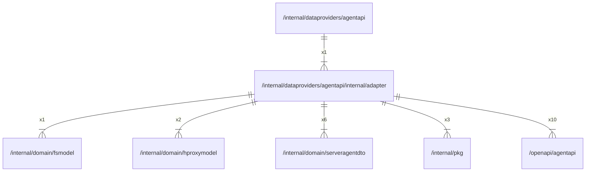

# adapter

## Imports

### Inner imports

| Name           | Path                                                                 | Count |
|:---------------|:---------------------------------------------------------------------|------:|
| agentapi       | [/openapi/agentapi](../../../../openapi/agentapi.md)                 |    10 |
| serveragentdto | [/internal/domain/serveragentdto](../../../domain/serveragentdto.md) |     6 |
| pkg            | [/internal/pkg](../../../pkg.md)                                     |     3 |
| hproxymodel    | [/internal/domain/hproxymodel](../../../domain/hproxymodel.md)       |     2 |
| fsmodel        | [/internal/domain/fsmodel](../../../domain/fsmodel.md)               |     1 |

### External imports

| Name | Path                   | Count |
|:-----|:-----------------------|------:|
| uuid | github.com/google/uuid |     1 |
| lo   | github.com/samber/lo   |     1 |

### Std imports

| Name    | Path     | Count |
|:--------|:---------|------:|
| context | context  |     8 |
| url     | net/url  |     4 |
| fmt     | fmt      |     3 |
| http    | net/http |     3 |
| errors  | errors   |     2 |
| io      | io       |     2 |
| time    | time     |     2 |
| syscall | syscall  |     1 |

## Used by

| Name     | Path                                                  |
|:---------|:------------------------------------------------------|
| agentapi | [/internal/dataproviders/agentapi](../../agentapi.md) |

## Scheme

---

> Generated by [goArchLint](https://github.com/gbh007/goarchlint)
