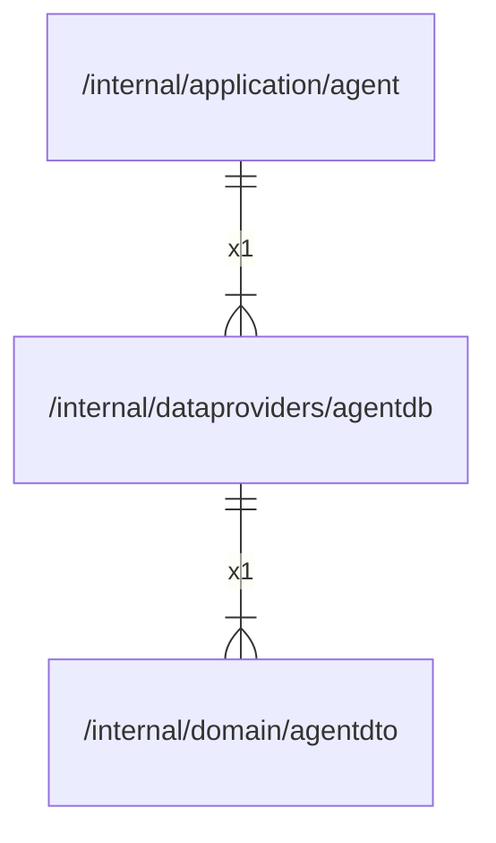

# agentdb

## Imports

### Inner imports

| Name     | Path                                               | Count |
|:---------|:---------------------------------------------------|------:|
| agentdto | [/internal/domain/agentdto](../domain/agentdto.md) |     1 |

### External imports

| Name      | Path                           | Count |
|:----------|:-------------------------------|------:|
| go-sqlite | github.com/glebarez/go-sqlite  |     1 |
| uuid      | github.com/google/uuid         |     1 |
| sqlx      | github.com/jmoiron/sqlx        |     1 |
| v3        | github.com/pressly/goose/v3    |     1 |
| v2        | github.com/qustavo/sqlhooks/v2 |     1 |

### Std imports

| Name    | Path         | Count |
|:--------|:-------------|------:|
| context | context      |     5 |
| sql     | database/sql |     3 |
| time    | time         |     3 |
| fmt     | fmt          |     2 |
| slog    | log/slog     |     2 |
| url     | net/url      |     2 |
| embed   | embed        |     1 |
| regexp  | regexp       |     1 |

## Used by

| Name  | Path                                                   |
|:------|:-------------------------------------------------------|
| agent | [/internal/application/agent](../application/agent.md) |

## Scheme

---

> Generated by [goArchLint](https://github.com/gbh007/goarchlint)
