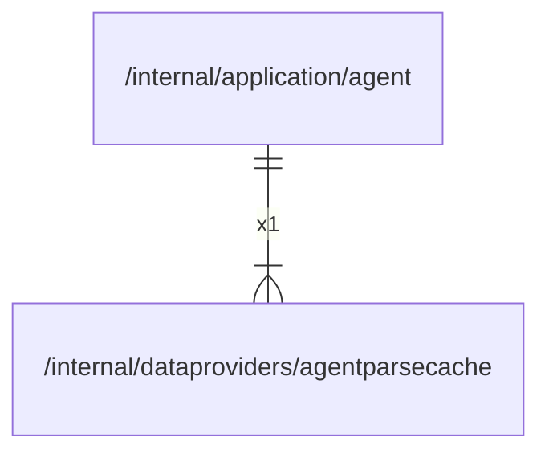

# agentparsecache

## Imports

### Std imports

| Name    | Path          | Count |
|:--------|:--------------|------:|
| slog    | log/slog      |     4 |
| os      | os            |     4 |
| path    | path          |     4 |
| time    | time          |     4 |
| context | context       |     3 |
| errors  | errors        |     3 |
| fmt     | fmt           |     2 |
| io      | io            |     2 |
| bytes   | bytes         |     1 |
| md5     | crypto/md5    |     1 |
| sha256  | crypto/sha256 |     1 |
| hex     | encoding/hex  |     1 |
| strconv | strconv       |     1 |
| strings | strings       |     1 |

## Used by

| Name  | Path                                                   |
|:------|:-------------------------------------------------------|
| agent | [/internal/application/agent](../application/agent.md) |

## Scheme

---

> Generated by [goArchLint](https://github.com/gbh007/goarchlint)
