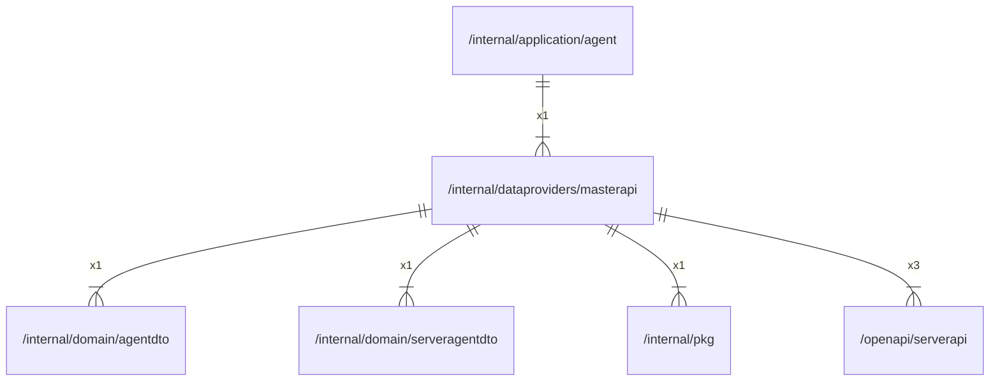

# masterapi

## Imports

### Inner imports

| Name           | Path                                                           | Count |
|:---------------|:---------------------------------------------------------------|------:|
| serverapi      | [/openapi/serverapi](../../openapi/serverapi.md)               |     3 |
| agentdto       | [/internal/domain/agentdto](../domain/agentdto.md)             |     1 |
| serveragentdto | [/internal/domain/serveragentdto](../domain/serveragentdto.md) |     1 |
| pkg            | [/internal/pkg](../pkg.md)                                     |     1 |

### External imports

| Name       | Path                               | Count |
|:-----------|:-----------------------------------|------:|
| ogenerrors | github.com/ogen-go/ogen/ogenerrors |     1 |

### Std imports

| Name    | Path     | Count |
|:--------|:---------|------:|
| context | context  |     2 |
| http    | net/http |     2 |
| errors  | errors   |     1 |
| fmt     | fmt      |     1 |
| io      | io       |     1 |
| url     | net/url  |     1 |
| time    | time     |     1 |

## Used by

| Name  | Path                                                   |
|:------|:-------------------------------------------------------|
| agent | [/internal/application/agent](../application/agent.md) |

## Scheme

---

> Generated by [goArchLint](https://github.com/gbh007/goarchlint)
