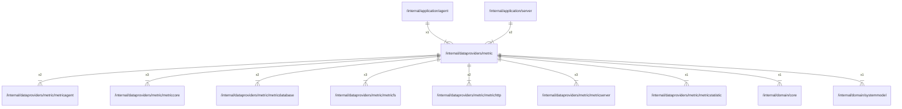

# metric

## Imports

### Inner imports

| Name            | Path                                                                        | Count |
|:----------------|:----------------------------------------------------------------------------|------:|
| metriccore      | [/internal/dataproviders/metric/metriccore](metric/metriccore.md)           |     3 |
| metricfs        | [/internal/dataproviders/metric/metricfs](metric/metricfs.md)               |     3 |
| metricserver    | [/internal/dataproviders/metric/metricserver](metric/metricserver.md)       |     3 |
| metricagent     | [/internal/dataproviders/metric/metricagent](metric/metricagent.md)         |     2 |
| metricdatabase  | [/internal/dataproviders/metric/metricdatabase](metric/metricdatabase.md)   |     2 |
| metrichttp      | [/internal/dataproviders/metric/metrichttp](metric/metrichttp.md)           |     2 |
| metricstatistic | [/internal/dataproviders/metric/metricstatistic](metric/metricstatistic.md) |     1 |
| core            | [/internal/domain/core](../domain/core.md)                                  |     1 |
| systemmodel     | [/internal/domain/systemmodel](../domain/systemmodel.md)                    |     1 |

### External imports

| Name       | Path                                                      | Count |
|:-----------|:----------------------------------------------------------|------:|
| uuid       | github.com/google/uuid                                    |     2 |
| prometheus | github.com/prometheus/client_golang/prometheus            |     1 |
| collectors | github.com/prometheus/client_golang/prometheus/collectors |     1 |

### Std imports

| Name    | Path     | Count |
|:--------|:---------|------:|
| time    | time     |     7 |
| fmt     | fmt      |     2 |
| context | context  |     1 |
| slog    | log/slog |     1 |
| sync    | sync     |     1 |

## Used by

| Name   | Path                                                     |
|:-------|:---------------------------------------------------------|
| agent  | [/internal/application/agent](../application/agent.md)   |
| server | [/internal/application/server](../application/server.md) |

## Scheme

---

> Generated by [goArchLint](https://github.com/gbh007/goarchlint)
