# generator

## Imports

### Inner imports

| Name             | Path                                                                                       | Count |
|:-----------------|:-------------------------------------------------------------------------------------------|------:|
| generatorcore    | [/internal/dataproviders/metric/generator/generatorcore](generator/generatorcore.md)       |     2 |
| metriccore       | [/internal/dataproviders/metric/metriccore](metriccore.md)                                 |     2 |
| bookandpages     | [/internal/dataproviders/metric/generator/bookandpages](generator/bookandpages.md)         |     1 |
| databasepanel    | [/internal/dataproviders/metric/generator/databasepanel](generator/databasepanel.md)       |     1 |
| httpserverpanel  | [/internal/dataproviders/metric/generator/httpserverpanel](generator/httpserverpanel.md)   |     1 |
| logspannel       | [/internal/dataproviders/metric/generator/logspannel](generator/logspannel.md)             |     1 |
| otherpanel       | [/internal/dataproviders/metric/generator/otherpanel](generator/otherpanel.md)             |     1 |
| simpleinfo       | [/internal/dataproviders/metric/generator/simpleinfo](generator/simpleinfo.md)             |     1 |
| statistic        | [/internal/dataproviders/metric/generator/statistic](generator/statistic.md)               |     1 |
| workersandagents | [/internal/dataproviders/metric/generator/workersandagents](generator/workersandagents.md) |     1 |

### External imports

| Name      | Path                                                     | Count |
|:----------|:---------------------------------------------------------|------:|
| dashboard | github.com/grafana/grafana-foundation-sdk/go/dashboard   |     4 |
| plugins   | github.com/grafana/grafana-foundation-sdk/go/cog/plugins |     1 |
| promql    | github.com/grafana/promql-builder/go/promql              |     1 |

### Std imports

| Name | Path | Count |
|:-----|:-----|------:|
| fmt  | fmt  |     2 |

## Used by

| Name             | Path                                                      |
|:-----------------|:----------------------------------------------------------|
| grafanagenerator | [/cmd/grafanagenerator](../../../cmd/grafanagenerator.md) |

## Scheme

```mermaid
erDiagram
    "/cmd/grafanagenerator" ||--|{ "/internal/dataproviders/metric/generator" : x1
    "/internal/dataproviders/metric/generator" ||--|{ "/internal/dataproviders/metric/generator/bookandpages" : x1
    "/internal/dataproviders/metric/generator" ||--|{ "/internal/dataproviders/metric/generator/databasepanel" : x1
    "/internal/dataproviders/metric/generator" ||--|{ "/internal/dataproviders/metric/generator/generatorcore" : x2
    "/internal/dataproviders/metric/generator" ||--|{ "/internal/dataproviders/metric/generator/httpserverpanel" : x1
    "/internal/dataproviders/metric/generator" ||--|{ "/internal/dataproviders/metric/generator/logspannel" : x1
    "/internal/dataproviders/metric/generator" ||--|{ "/internal/dataproviders/metric/generator/otherpanel" : x1
    "/internal/dataproviders/metric/generator" ||--|{ "/internal/dataproviders/metric/generator/simpleinfo" : x1
    "/internal/dataproviders/metric/generator" ||--|{ "/internal/dataproviders/metric/generator/statistic" : x1
    "/internal/dataproviders/metric/generator" ||--|{ "/internal/dataproviders/metric/generator/workersandagents" : x1
    "/internal/dataproviders/metric/generator" ||--|{ "/internal/dataproviders/metric/metriccore" : x2
```

---

> Generated by [goArchLint](https://github.com/gbh007/goarchlint)
