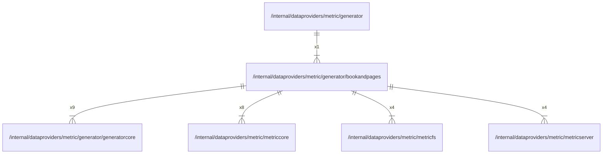

# bookandpages

## Imports

### Inner imports

| Name          | Path                                                                       | Count |
|:--------------|:---------------------------------------------------------------------------|------:|
| generatorcore | [/internal/dataproviders/metric/generator/generatorcore](generatorcore.md) |     9 |
| metriccore    | [/internal/dataproviders/metric/metriccore](../metriccore.md)              |     8 |
| metricfs      | [/internal/dataproviders/metric/metricfs](../metricfs.md)                  |     4 |
| metricserver  | [/internal/dataproviders/metric/metricserver](../metricserver.md)          |     4 |

### External imports

| Name       | Path                                                    | Count |
|:-----------|:--------------------------------------------------------|------:|
| timeseries | github.com/grafana/grafana-foundation-sdk/go/timeseries |     8 |
| dashboard  | github.com/grafana/grafana-foundation-sdk/go/dashboard  |     1 |

### Std imports

| Name | Path | Count |
|:-----|:-----|------:|
| fmt  | fmt  |     8 |

## Used by

| Name      | Path                                                        |
|:----------|:------------------------------------------------------------|
| generator | [/internal/dataproviders/metric/generator](../generator.md) |

## Scheme

---

> Generated by [goArchLint](https://github.com/gbh007/goarchlint)
