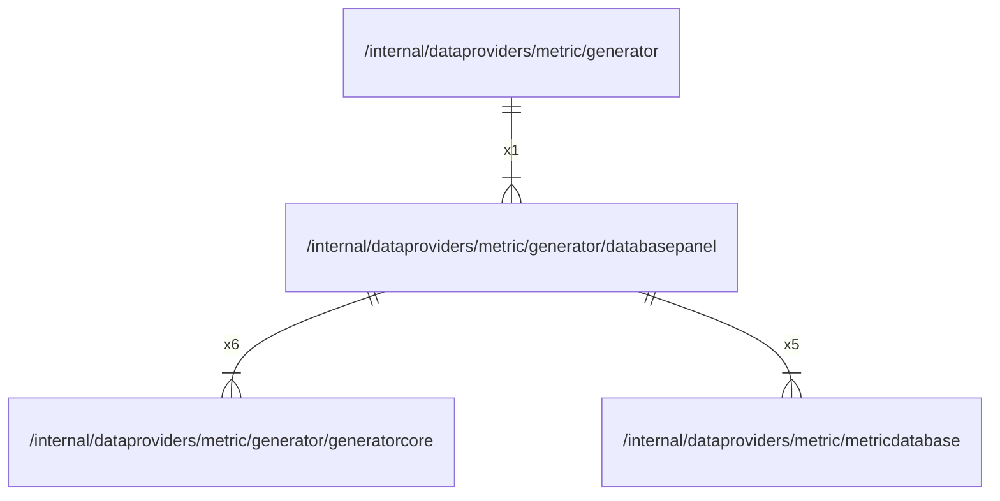

# databasepanel

## Imports

### Inner imports

| Name           | Path                                                                       | Count |
|:---------------|:---------------------------------------------------------------------------|------:|
| generatorcore  | [/internal/dataproviders/metric/generator/generatorcore](generatorcore.md) |     6 |
| metricdatabase | [/internal/dataproviders/metric/metricdatabase](../metricdatabase.md)      |     5 |

### External imports

| Name       | Path                                                    | Count |
|:-----------|:--------------------------------------------------------|------:|
| timeseries | github.com/grafana/grafana-foundation-sdk/go/timeseries |     4 |
| dashboard  | github.com/grafana/grafana-foundation-sdk/go/dashboard  |     1 |
| table      | github.com/grafana/grafana-foundation-sdk/go/table      |     1 |
| promql     | github.com/grafana/promql-builder/go/promql             |     1 |

### Std imports

| Name | Path | Count |
|:-----|:-----|------:|
| fmt  | fmt  |     5 |

## Used by

| Name      | Path                                                        |
|:----------|:------------------------------------------------------------|
| generator | [/internal/dataproviders/metric/generator](../generator.md) |

## Scheme

---

> Generated by [goArchLint](https://github.com/gbh007/goarchlint)
