# generatorcore

## Imports

### Inner imports

| Name       | Path                                                          | Count |
|:-----------|:--------------------------------------------------------------|------:|
| metriccore | [/internal/dataproviders/metric/metriccore](../metriccore.md) |     1 |
| pkg        | [/internal/pkg](../../../pkg.md)                              |     1 |

### External imports

| Name       | Path                                                      | Count |
|:-----------|:----------------------------------------------------------|------:|
| dashboard  | github.com/grafana/grafana-foundation-sdk/go/dashboard    |     4 |
| common     | github.com/grafana/grafana-foundation-sdk/go/common       |     2 |
| promql     | github.com/grafana/promql-builder/go/promql               |     2 |
| cog        | github.com/grafana/grafana-foundation-sdk/go/cog          |     1 |
| variants   | github.com/grafana/grafana-foundation-sdk/go/cog/variants |     1 |
| prometheus | github.com/grafana/grafana-foundation-sdk/go/prometheus   |     1 |
| table      | github.com/grafana/grafana-foundation-sdk/go/table        |     1 |
| timeseries | github.com/grafana/grafana-foundation-sdk/go/timeseries   |     1 |
| units      | github.com/grafana/grafana-foundation-sdk/go/units        |     1 |
| cog        | github.com/grafana/promql-builder/go/cog                  |     1 |

### Std imports

| Name    | Path    | Count |
|:--------|:--------|------:|
| strings | strings |     1 |

## Used by

| Name             | Path                                                                             |
|:-----------------|:---------------------------------------------------------------------------------|
| generator        | [/internal/dataproviders/metric/generator](../generator.md)                      |
| bookandpages     | [/internal/dataproviders/metric/generator/bookandpages](bookandpages.md)         |
| databasepanel    | [/internal/dataproviders/metric/generator/databasepanel](databasepanel.md)       |
| httpserverpanel  | [/internal/dataproviders/metric/generator/httpserverpanel](httpserverpanel.md)   |
| logspannel       | [/internal/dataproviders/metric/generator/logspannel](logspannel.md)             |
| otherpanel       | [/internal/dataproviders/metric/generator/otherpanel](otherpanel.md)             |
| simpleinfo       | [/internal/dataproviders/metric/generator/simpleinfo](simpleinfo.md)             |
| statistic        | [/internal/dataproviders/metric/generator/statistic](statistic.md)               |
| workersandagents | [/internal/dataproviders/metric/generator/workersandagents](workersandagents.md) |

## Scheme

```mermaid
erDiagram
    "/internal/dataproviders/metric/generator" ||--|{ "/internal/dataproviders/metric/generator/generatorcore" : x2
    "/internal/dataproviders/metric/generator/bookandpages" ||--|{ "/internal/dataproviders/metric/generator/generatorcore" : x9
    "/internal/dataproviders/metric/generator/databasepanel" ||--|{ "/internal/dataproviders/metric/generator/generatorcore" : x6
    "/internal/dataproviders/metric/generator/generatorcore" ||--|{ "/internal/dataproviders/metric/metriccore" : x1
    "/internal/dataproviders/metric/generator/generatorcore" ||--|{ "/internal/pkg" : x1
    "/internal/dataproviders/metric/generator/httpserverpanel" ||--|{ "/internal/dataproviders/metric/generator/generatorcore" : x5
    "/internal/dataproviders/metric/generator/logspannel" ||--|{ "/internal/dataproviders/metric/generator/generatorcore" : x2
    "/internal/dataproviders/metric/generator/otherpanel" ||--|{ "/internal/dataproviders/metric/generator/generatorcore" : x5
    "/internal/dataproviders/metric/generator/simpleinfo" ||--|{ "/internal/dataproviders/metric/generator/generatorcore" : x13
    "/internal/dataproviders/metric/generator/statistic" ||--|{ "/internal/dataproviders/metric/generator/generatorcore" : x2
    "/internal/dataproviders/metric/generator/workersandagents" ||--|{ "/internal/dataproviders/metric/generator/generatorcore" : x7
```

---

> Generated by [goArchLint](https://github.com/gbh007/goarchlint)
