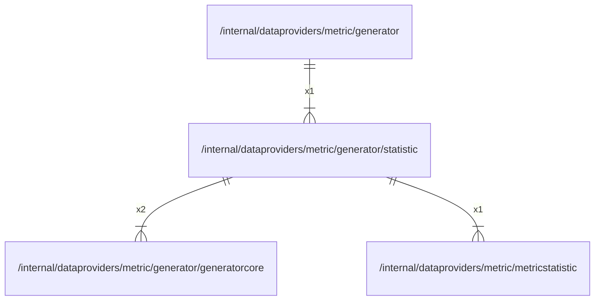

# statistic

## Imports

### Inner imports

| Name            | Path                                                                       | Count |
|:----------------|:---------------------------------------------------------------------------|------:|
| generatorcore   | [/internal/dataproviders/metric/generator/generatorcore](generatorcore.md) |     2 |
| metricstatistic | [/internal/dataproviders/metric/metricstatistic](../metricstatistic.md)    |     1 |

### External imports

| Name       | Path                                                      | Count |
|:-----------|:----------------------------------------------------------|------:|
| heatmap    | github.com/grafana/grafana-foundation-sdk/go/heatmap      |     2 |
| cog        | github.com/grafana/grafana-foundation-sdk/go/cog          |     1 |
| variants   | github.com/grafana/grafana-foundation-sdk/go/cog/variants |     1 |
| common     | github.com/grafana/grafana-foundation-sdk/go/common       |     1 |
| dashboard  | github.com/grafana/grafana-foundation-sdk/go/dashboard    |     1 |
| prometheus | github.com/grafana/grafana-foundation-sdk/go/prometheus   |     1 |
| promql     | github.com/grafana/promql-builder/go/promql               |     1 |

## Used by

| Name      | Path                                                        |
|:----------|:------------------------------------------------------------|
| generator | [/internal/dataproviders/metric/generator](../generator.md) |

## Scheme

---

> Generated by [goArchLint](https://github.com/gbh007/goarchlint)
