# metriccore

## Imports

### Inner imports

| Name    | Path                                  | Count |
|:--------|:--------------------------------------|------:|
| version | [/internal/version](../../version.md) |     1 |

### External imports

| Name       | Path                                           | Count |
|:-----------|:-----------------------------------------------|------:|
| prometheus | github.com/prometheus/client_golang/prometheus |     2 |

## Used by

| Name             | Path                                                                                       |
|:-----------------|:-------------------------------------------------------------------------------------------|
| metric           | [/internal/dataproviders/metric](../metric.md)                                             |
| generator        | [/internal/dataproviders/metric/generator](generator.md)                                   |
| bookandpages     | [/internal/dataproviders/metric/generator/bookandpages](generator/bookandpages.md)         |
| generatorcore    | [/internal/dataproviders/metric/generator/generatorcore](generator/generatorcore.md)       |
| httpserverpanel  | [/internal/dataproviders/metric/generator/httpserverpanel](generator/httpserverpanel.md)   |
| otherpanel       | [/internal/dataproviders/metric/generator/otherpanel](generator/otherpanel.md)             |
| simpleinfo       | [/internal/dataproviders/metric/generator/simpleinfo](generator/simpleinfo.md)             |
| workersandagents | [/internal/dataproviders/metric/generator/workersandagents](generator/workersandagents.md) |
| metricagent      | [/internal/dataproviders/metric/metricagent](metricagent.md)                               |
| metricdatabase   | [/internal/dataproviders/metric/metricdatabase](metricdatabase.md)                         |
| metricfs         | [/internal/dataproviders/metric/metricfs](metricfs.md)                                     |
| metrichttp       | [/internal/dataproviders/metric/metrichttp](metrichttp.md)                                 |
| metricserver     | [/internal/dataproviders/metric/metricserver](metricserver.md)                             |
| metricstatistic  | [/internal/dataproviders/metric/metricstatistic](metricstatistic.md)                       |

## Scheme

```mermaid
erDiagram
    "/internal/dataproviders/metric" ||--|{ "/internal/dataproviders/metric/metriccore" : x3
    "/internal/dataproviders/metric/generator" ||--|{ "/internal/dataproviders/metric/metriccore" : x2
    "/internal/dataproviders/metric/generator/bookandpages" ||--|{ "/internal/dataproviders/metric/metriccore" : x8
    "/internal/dataproviders/metric/generator/generatorcore" ||--|{ "/internal/dataproviders/metric/metriccore" : x1
    "/internal/dataproviders/metric/generator/httpserverpanel" ||--|{ "/internal/dataproviders/metric/metriccore" : x4
    "/internal/dataproviders/metric/generator/otherpanel" ||--|{ "/internal/dataproviders/metric/metriccore" : x3
    "/internal/dataproviders/metric/generator/simpleinfo" ||--|{ "/internal/dataproviders/metric/metriccore" : x12
    "/internal/dataproviders/metric/generator/workersandagents" ||--|{ "/internal/dataproviders/metric/metriccore" : x3
    "/internal/dataproviders/metric/metricagent" ||--|{ "/internal/dataproviders/metric/metriccore" : x2
    "/internal/dataproviders/metric/metriccore" ||--|{ "/internal/version" : x1
    "/internal/dataproviders/metric/metricdatabase" ||--|{ "/internal/dataproviders/metric/metriccore" : x1
    "/internal/dataproviders/metric/metricfs" ||--|{ "/internal/dataproviders/metric/metriccore" : x2
    "/internal/dataproviders/metric/metrichttp" ||--|{ "/internal/dataproviders/metric/metriccore" : x1
    "/internal/dataproviders/metric/metricserver" ||--|{ "/internal/dataproviders/metric/metriccore" : x2
    "/internal/dataproviders/metric/metricstatistic" ||--|{ "/internal/dataproviders/metric/metriccore" : x2
```

---

> Generated by [goArchLint](https://github.com/gbh007/goarchlint)
