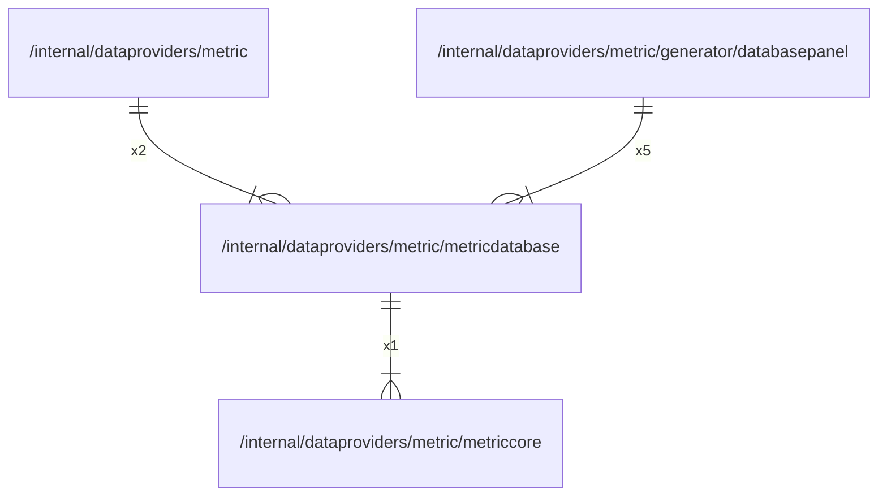

# metricdatabase

## Imports

### Inner imports

| Name       | Path                                                       | Count |
|:-----------|:-----------------------------------------------------------|------:|
| metriccore | [/internal/dataproviders/metric/metriccore](metriccore.md) |     1 |

### External imports

| Name       | Path                                           | Count |
|:-----------|:-----------------------------------------------|------:|
| prometheus | github.com/prometheus/client_golang/prometheus |     2 |

## Used by

| Name          | Path                                                                                 |
|:--------------|:-------------------------------------------------------------------------------------|
| metric        | [/internal/dataproviders/metric](../metric.md)                                       |
| databasepanel | [/internal/dataproviders/metric/generator/databasepanel](generator/databasepanel.md) |

## Scheme

---

> Generated by [goArchLint](https://github.com/gbh007/goarchlint)
