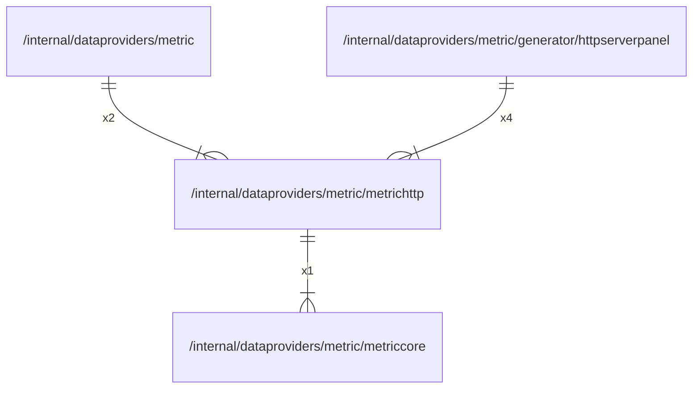

# metrichttp

## Imports

### Inner imports

| Name       | Path                                                       | Count |
|:-----------|:-----------------------------------------------------------|------:|
| metriccore | [/internal/dataproviders/metric/metriccore](metriccore.md) |     1 |

### External imports

| Name       | Path                                           | Count |
|:-----------|:-----------------------------------------------|------:|
| prometheus | github.com/prometheus/client_golang/prometheus |     2 |

## Used by

| Name            | Path                                                                                     |
|:----------------|:-----------------------------------------------------------------------------------------|
| metric          | [/internal/dataproviders/metric](../metric.md)                                           |
| httpserverpanel | [/internal/dataproviders/metric/generator/httpserverpanel](generator/httpserverpanel.md) |

## Scheme

---

> Generated by [goArchLint](https://github.com/gbh007/goarchlint)
