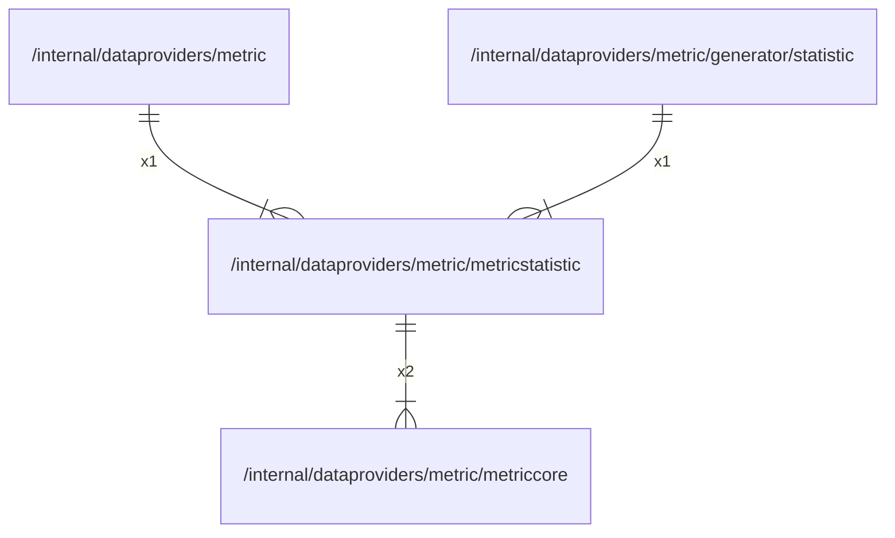

# metricstatistic

## Imports

### Inner imports

| Name       | Path                                                       | Count |
|:-----------|:-----------------------------------------------------------|------:|
| metriccore | [/internal/dataproviders/metric/metriccore](metriccore.md) |     2 |

### External imports

| Name       | Path                                           | Count |
|:-----------|:-----------------------------------------------|------:|
| prometheus | github.com/prometheus/client_golang/prometheus |     2 |

### Std imports

| Name   | Path        | Count |
|:-------|:------------|------:|
| atomic | sync/atomic |     1 |

## Used by

| Name      | Path                                                                         |
|:----------|:-----------------------------------------------------------------------------|
| metric    | [/internal/dataproviders/metric](../metric.md)                               |
| statistic | [/internal/dataproviders/metric/generator/statistic](generator/statistic.md) |

## Scheme

---

> Generated by [goArchLint](https://github.com/gbh007/goarchlint)
