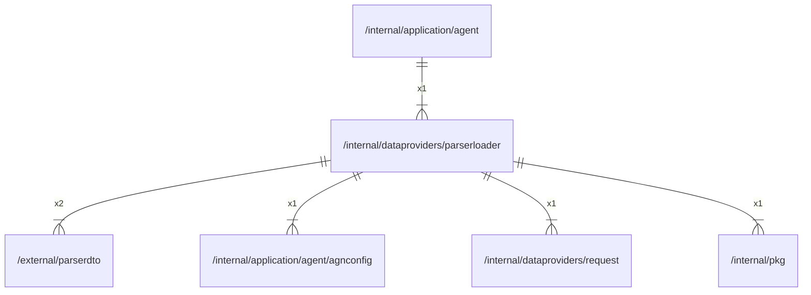

# parserloader

## Imports

### Inner imports

| Name      | Path                                                                       | Count |
|:----------|:---------------------------------------------------------------------------|------:|
| parserdto | [/external/parserdto](../../external/parserdto.md)                         |     2 |
| agnconfig | [/internal/application/agent/agnconfig](../application/agent/agnconfig.md) |     1 |
| request   | [/internal/dataproviders/request](request.md)                              |     1 |
| pkg       | [/internal/pkg](../pkg.md)                                                 |     1 |

### External imports

| Name  | Path                   | Count |
|:------|:-----------------------|------:|
| proxy | golang.org/x/net/proxy |     1 |

### Std imports

| Name    | Path     | Count |
|:--------|:---------|------:|
| time    | time     |     2 |
| context | context  |     1 |
| errors  | errors   |     1 |
| fmt     | fmt      |     1 |
| io      | io       |     1 |
| slog    | log/slog |     1 |
| http    | net/http |     1 |
| url     | net/url  |     1 |

## Used by

| Name  | Path                                                   |
|:------|:-------------------------------------------------------|
| agent | [/internal/application/agent](../application/agent.md) |

## Scheme

---

> Generated by [goArchLint](https://github.com/gbh007/goarchlint)
