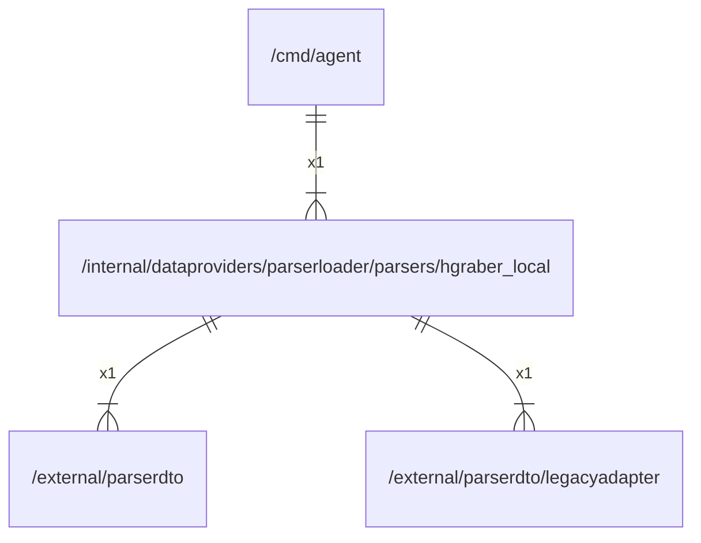

# hgraber_local

## Imports

### Inner imports

| Name          | Path                                                                                 | Count |
|:--------------|:-------------------------------------------------------------------------------------|------:|
| parserdto     | [/external/parserdto](../../../../external/parserdto.md)                             |     1 |
| legacyadapter | [/external/parserdto/legacyadapter](../../../../external/parserdto/legacyadapter.md) |     1 |

### Std imports

| Name    | Path          | Count |
|:--------|:--------------|------:|
| bytes   | bytes         |     1 |
| context | context       |     1 |
| json    | encoding/json |     1 |
| errors  | errors        |     1 |
| fmt     | fmt           |     1 |
| io      | io            |     1 |
| http    | net/http      |     1 |
| url     | net/url       |     1 |
| os      | os            |     1 |
| path    | path          |     1 |
| strconv | strconv       |     1 |
| strings | strings       |     1 |
| time    | time          |     1 |

## Used by

| Name  | Path                                   |
|:------|:---------------------------------------|
| agent | [/cmd/agent](../../../../cmd/agent.md) |

## Scheme

---

> Generated by [goArchLint](https://github.com/gbh007/goarchlint)
