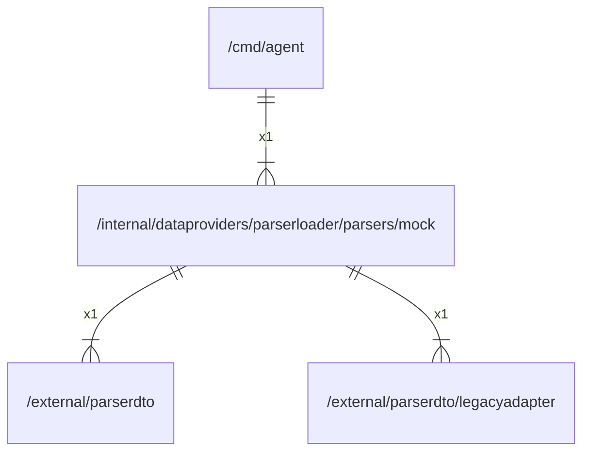

# mock

## Imports

### Inner imports

| Name          | Path                                                                                 | Count |
|:--------------|:-------------------------------------------------------------------------------------|------:|
| parserdto     | [/external/parserdto](../../../../external/parserdto.md)                             |     1 |
| legacyadapter | [/external/parserdto/legacyadapter](../../../../external/parserdto/legacyadapter.md) |     1 |

### Std imports

| Name    | Path    | Count |
|:--------|:--------|------:|
| context | context |     1 |
| errors  | errors  |     1 |
| fmt     | fmt     |     1 |
| url     | net/url |     1 |
| regexp  | regexp  |     1 |
| strings | strings |     1 |

## Used by

| Name  | Path                                   |
|:------|:---------------------------------------|
| agent | [/cmd/agent](../../../../cmd/agent.md) |

## Scheme

---

> Generated by [goArchLint](https://github.com/gbh007/goarchlint)
