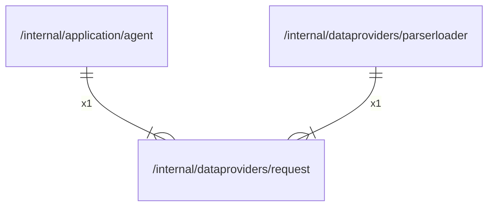

# request

## Imports

### Std imports

| Name    | Path     | Count |
|:--------|:---------|------:|
| bytes   | bytes    |     3 |
| io      | io       |     3 |
| http    | net/http |     3 |
| context | context  |     2 |
| slog    | log/slog |     2 |
| fmt     | fmt      |     1 |
| strconv | strconv  |     1 |
| strings | strings  |     1 |
| time    | time     |     1 |

## Used by

| Name         | Path                                                    |
|:-------------|:--------------------------------------------------------|
| agent        | [/internal/application/agent](../application/agent.md)  |
| parserloader | [/internal/dataproviders/parserloader](parserloader.md) |

## Scheme

---

> Generated by [goArchLint](https://github.com/gbh007/goarchlint)
