# serverdb

## Imports

### Inner imports

| Name       | Path                                                                                    | Count |
|:-----------|:----------------------------------------------------------------------------------------|------:|
| agent      | [/internal/dataproviders/serverdb/internal/agent](serverdb/internal/agent.md)           |     1 |
| attribute  | [/internal/dataproviders/serverdb/internal/attribute](serverdb/internal/attribute.md)   |     1 |
| book       | [/internal/dataproviders/serverdb/internal/book](serverdb/internal/book.md)             |     1 |
| deadhash   | [/internal/dataproviders/serverdb/internal/deadhash](serverdb/internal/deadhash.md)     |     1 |
| file       | [/internal/dataproviders/serverdb/internal/file](serverdb/internal/file.md)             |     1 |
| label      | [/internal/dataproviders/serverdb/internal/label](serverdb/internal/label.md)           |     1 |
| massload   | [/internal/dataproviders/serverdb/internal/massload](serverdb/internal/massload.md)     |     1 |
| other      | [/internal/dataproviders/serverdb/internal/other](serverdb/internal/other.md)           |     1 |
| page       | [/internal/dataproviders/serverdb/internal/page](serverdb/internal/page.md)             |     1 |
| repository | [/internal/dataproviders/serverdb/internal/repository](serverdb/internal/repository.md) |     1 |
| urlmirror  | [/internal/dataproviders/serverdb/internal/urlmirror](serverdb/internal/urlmirror.md)   |     1 |

### Std imports

| Name    | Path     | Count |
|:--------|:---------|------:|
| context | context  |     1 |
| fmt     | fmt      |     1 |
| slog    | log/slog |     1 |

## Used by

| Name   | Path                                                     |
|:-------|:---------------------------------------------------------|
| server | [/internal/application/server](../application/server.md) |

## Scheme

```mermaid
erDiagram
    "/internal/application/server" ||--|{ "/internal/dataproviders/serverdb" : x2
    "/internal/dataproviders/serverdb" ||--|{ "/internal/dataproviders/serverdb/internal/agent" : x1
    "/internal/dataproviders/serverdb" ||--|{ "/internal/dataproviders/serverdb/internal/attribute" : x1
    "/internal/dataproviders/serverdb" ||--|{ "/internal/dataproviders/serverdb/internal/book" : x1
    "/internal/dataproviders/serverdb" ||--|{ "/internal/dataproviders/serverdb/internal/deadhash" : x1
    "/internal/dataproviders/serverdb" ||--|{ "/internal/dataproviders/serverdb/internal/file" : x1
    "/internal/dataproviders/serverdb" ||--|{ "/internal/dataproviders/serverdb/internal/label" : x1
    "/internal/dataproviders/serverdb" ||--|{ "/internal/dataproviders/serverdb/internal/massload" : x1
    "/internal/dataproviders/serverdb" ||--|{ "/internal/dataproviders/serverdb/internal/other" : x1
    "/internal/dataproviders/serverdb" ||--|{ "/internal/dataproviders/serverdb/internal/page" : x1
    "/internal/dataproviders/serverdb" ||--|{ "/internal/dataproviders/serverdb/internal/repository" : x1
    "/internal/dataproviders/serverdb" ||--|{ "/internal/dataproviders/serverdb/internal/urlmirror" : x1
```

---

> Generated by [goArchLint](https://github.com/gbh007/goarchlint)
