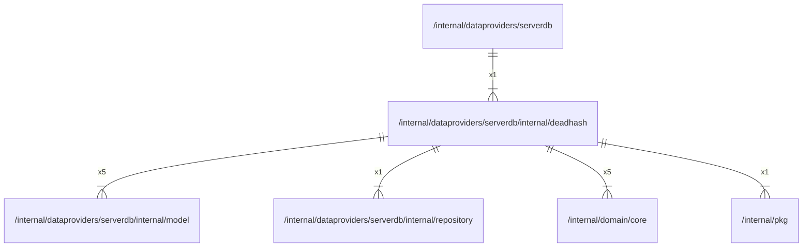

# deadhash

## Imports

### Inner imports

| Name       | Path                                                                  | Count |
|:-----------|:----------------------------------------------------------------------|------:|
| model      | [/internal/dataproviders/serverdb/internal/model](model.md)           |     5 |
| core       | [/internal/domain/core](../../../domain/core.md)                      |     5 |
| repository | [/internal/dataproviders/serverdb/internal/repository](repository.md) |     1 |
| pkg        | [/internal/pkg](../../../pkg.md)                                      |     1 |

### External imports

| Name     | Path                            | Count |
|:---------|:--------------------------------|------:|
| squirrel | github.com/Masterminds/squirrel |     5 |
| v5       | github.com/jackc/pgx/v5         |     1 |

### Std imports

| Name    | Path     | Count |
|:--------|:---------|------:|
| context | context  |     5 |
| fmt     | fmt      |     5 |
| slog    | log/slog |     1 |

## Used by

| Name     | Path                                                  |
|:---------|:------------------------------------------------------|
| serverdb | [/internal/dataproviders/serverdb](../../serverdb.md) |

## Scheme

---

> Generated by [goArchLint](https://github.com/gbh007/goarchlint)
