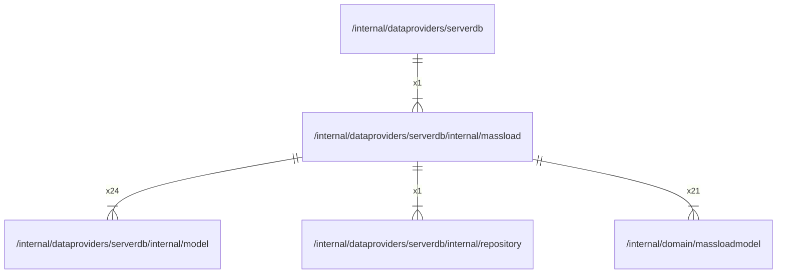

# massload

## Imports

### Inner imports

| Name          | Path                                                                  | Count |
|:--------------|:----------------------------------------------------------------------|------:|
| model         | [/internal/dataproviders/serverdb/internal/model](model.md)           |    24 |
| massloadmodel | [/internal/domain/massloadmodel](../../../domain/massloadmodel.md)    |    21 |
| repository    | [/internal/dataproviders/serverdb/internal/repository](repository.md) |     1 |

### External imports

| Name     | Path                            | Count |
|:---------|:--------------------------------|------:|
| squirrel | github.com/Masterminds/squirrel |    24 |

### Std imports

| Name    | Path    | Count |
|:--------|:--------|------:|
| context | context |    24 |
| fmt     | fmt     |    24 |
| url     | net/url |     2 |

## Used by

| Name     | Path                                                  |
|:---------|:------------------------------------------------------|
| serverdb | [/internal/dataproviders/serverdb](../../serverdb.md) |

## Scheme

---

> Generated by [goArchLint](https://github.com/gbh007/goarchlint)
