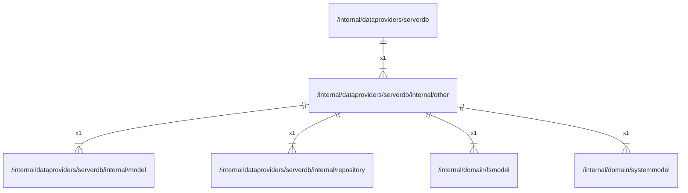

# other

## Imports

### Inner imports

| Name        | Path                                                                  | Count |
|:------------|:----------------------------------------------------------------------|------:|
| model       | [/internal/dataproviders/serverdb/internal/model](model.md)           |     1 |
| repository  | [/internal/dataproviders/serverdb/internal/repository](repository.md) |     1 |
| fsmodel     | [/internal/domain/fsmodel](../../../domain/fsmodel.md)                |     1 |
| systemmodel | [/internal/domain/systemmodel](../../../domain/systemmodel.md)        |     1 |

### External imports

| Name     | Path                            | Count |
|:---------|:--------------------------------|------:|
| squirrel | github.com/Masterminds/squirrel |     1 |
| uuid     | github.com/google/uuid          |     1 |
| v5       | github.com/jackc/pgx/v5         |     1 |

### Std imports

| Name    | Path         | Count |
|:--------|:-------------|------:|
| context | context      |     1 |
| sql     | database/sql |     1 |
| fmt     | fmt          |     1 |

## Used by

| Name     | Path                                                  |
|:---------|:------------------------------------------------------|
| serverdb | [/internal/dataproviders/serverdb](../../serverdb.md) |

## Scheme

---

> Generated by [goArchLint](https://github.com/gbh007/goarchlint)
