# repository

## Imports

### Inner imports

| Name | Path                             | Count |
|:-----|:---------------------------------|------:|
| pkg  | [/internal/pkg](../../../pkg.md) |     1 |

### External imports

| Name    | Path                            | Count |
|:--------|:--------------------------------|------:|
| v5      | github.com/jackc/pgx/v5         |     1 |
| pgxpool | github.com/jackc/pgx/v5/pgxpool |     1 |
| stdlib  | github.com/jackc/pgx/v5/stdlib  |     1 |
| v3      | github.com/pressly/goose/v3     |     1 |

### Std imports

| Name    | Path         | Count |
|:--------|:-------------|------:|
| context | context      |     3 |
| slog    | log/slog     |     3 |
| fmt     | fmt          |     2 |
| time    | time         |     2 |
| sql     | database/sql |     1 |
| embed   | embed        |     1 |
| regexp  | regexp       |     1 |
| slices  | slices       |     1 |
| strings | strings      |     1 |

## Used by

| Name      | Path                                                                |
|:----------|:--------------------------------------------------------------------|
| serverdb  | [/internal/dataproviders/serverdb](../../serverdb.md)               |
| agent     | [/internal/dataproviders/serverdb/internal/agent](agent.md)         |
| attribute | [/internal/dataproviders/serverdb/internal/attribute](attribute.md) |
| book      | [/internal/dataproviders/serverdb/internal/book](book.md)           |
| deadhash  | [/internal/dataproviders/serverdb/internal/deadhash](deadhash.md)   |
| file      | [/internal/dataproviders/serverdb/internal/file](file.md)           |
| label     | [/internal/dataproviders/serverdb/internal/label](label.md)         |
| massload  | [/internal/dataproviders/serverdb/internal/massload](massload.md)   |
| other     | [/internal/dataproviders/serverdb/internal/other](other.md)         |
| page      | [/internal/dataproviders/serverdb/internal/page](page.md)           |
| urlmirror | [/internal/dataproviders/serverdb/internal/urlmirror](urlmirror.md) |

## Scheme

```mermaid
erDiagram
    "/internal/dataproviders/serverdb" ||--|{ "/internal/dataproviders/serverdb/internal/repository" : x1
    "/internal/dataproviders/serverdb/internal/agent" ||--|{ "/internal/dataproviders/serverdb/internal/repository" : x1
    "/internal/dataproviders/serverdb/internal/attribute" ||--|{ "/internal/dataproviders/serverdb/internal/repository" : x1
    "/internal/dataproviders/serverdb/internal/book" ||--|{ "/internal/dataproviders/serverdb/internal/repository" : x1
    "/internal/dataproviders/serverdb/internal/deadhash" ||--|{ "/internal/dataproviders/serverdb/internal/repository" : x1
    "/internal/dataproviders/serverdb/internal/file" ||--|{ "/internal/dataproviders/serverdb/internal/repository" : x1
    "/internal/dataproviders/serverdb/internal/label" ||--|{ "/internal/dataproviders/serverdb/internal/repository" : x1
    "/internal/dataproviders/serverdb/internal/massload" ||--|{ "/internal/dataproviders/serverdb/internal/repository" : x1
    "/internal/dataproviders/serverdb/internal/other" ||--|{ "/internal/dataproviders/serverdb/internal/repository" : x1
    "/internal/dataproviders/serverdb/internal/page" ||--|{ "/internal/dataproviders/serverdb/internal/repository" : x1
    "/internal/dataproviders/serverdb/internal/repository" ||--|{ "/internal/pkg" : x1
    "/internal/dataproviders/serverdb/internal/urlmirror" ||--|{ "/internal/dataproviders/serverdb/internal/repository" : x1
```

---

> Generated by [goArchLint](https://github.com/gbh007/goarchlint)
