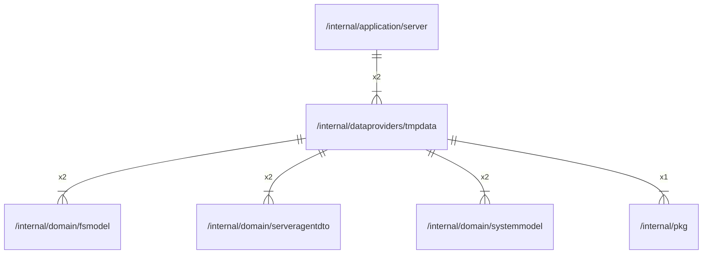

# tmpdata

## Imports

### Inner imports

| Name           | Path                                                           | Count |
|:---------------|:---------------------------------------------------------------|------:|
| fsmodel        | [/internal/domain/fsmodel](../domain/fsmodel.md)               |     2 |
| serveragentdto | [/internal/domain/serveragentdto](../domain/serveragentdto.md) |     2 |
| systemmodel    | [/internal/domain/systemmodel](../domain/systemmodel.md)       |     2 |
| pkg            | [/internal/pkg](../pkg.md)                                     |     1 |

### External imports

| Name | Path                   | Count |
|:-----|:-----------------------|------:|
| uuid | github.com/google/uuid |     2 |

### Std imports

| Name | Path | Count |
|:-----|:-----|------:|
| sync | sync |     1 |

## Used by

| Name   | Path                                                     |
|:-------|:---------------------------------------------------------|
| server | [/internal/application/server](../application/server.md) |

## Scheme

---

> Generated by [goArchLint](https://github.com/gbh007/goarchlint)
