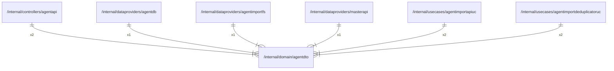

# agentdto

## Imports

### External imports

| Name | Path                   | Count |
|:-----|:-----------------------|------:|
| uuid | github.com/google/uuid |     2 |

### Std imports

| Name | Path    | Count |
|:-----|:--------|------:|
| url  | net/url |     2 |
| io   | io      |     1 |
| time | time    |     1 |

## Used by

| Name                      | Path                                                                                     |
|:--------------------------|:-----------------------------------------------------------------------------------------|
| agentapi                  | [/internal/controllers/agentapi](../controllers/agentapi.md)                             |
| agentdb                   | [/internal/dataproviders/agentdb](../dataproviders/agentdb.md)                           |
| agentimportfs             | [/internal/dataproviders/agentimportfs](../dataproviders/agentimportfs.md)               |
| masterapi                 | [/internal/dataproviders/masterapi](../dataproviders/masterapi.md)                       |
| agentimportapiuc          | [/internal/usecases/agentimportapiuc](../usecases/agentimportapiuc.md)                   |
| agentimportdeduplicatoruc | [/internal/usecases/agentimportdeduplicatoruc](../usecases/agentimportdeduplicatoruc.md) |

## Scheme

---

> Generated by [goArchLint](https://github.com/gbh007/goarchlint)
