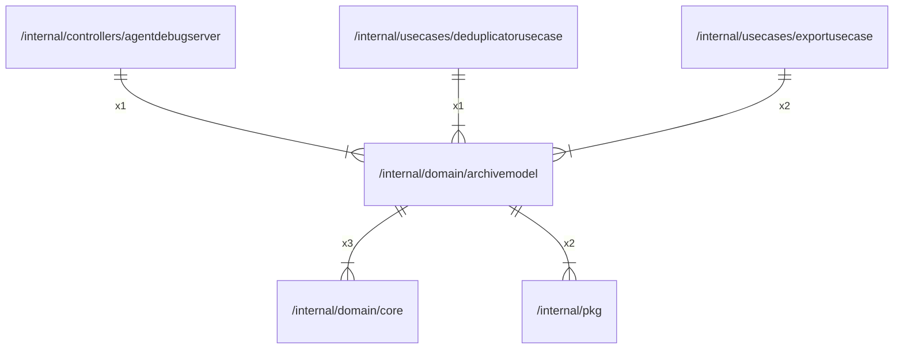

# archivemodel

## Imports

### Inner imports

| Name | Path                             | Count |
|:-----|:---------------------------------|------:|
| core | [/internal/domain/core](core.md) |     3 |
| pkg  | [/internal/pkg](../pkg.md)       |     2 |

### External imports

| Name | Path                   | Count |
|:-----|:-----------------------|------:|
| uuid | github.com/google/uuid |     1 |

### Std imports

| Name    | Path          | Count |
|:--------|:--------------|------:|
| fmt     | fmt           |     4 |
| io      | io            |     4 |
| zip     | archive/zip   |     3 |
| context | context       |     3 |
| json    | encoding/json |     3 |
| strings | strings       |     3 |
| time    | time          |     3 |
| errors  | errors        |     2 |
| strconv | strconv       |     2 |
| url     | net/url       |     1 |

## Used by

| Name                | Path                                                                         |
|:--------------------|:-----------------------------------------------------------------------------|
| agentdebugserver    | [/internal/controllers/agentdebugserver](../controllers/agentdebugserver.md) |
| deduplicatorusecase | [/internal/usecases/deduplicatorusecase](../usecases/deduplicatorusecase.md) |
| exportusecase       | [/internal/usecases/exportusecase](../usecases/exportusecase.md)             |

## Scheme

---

> Generated by [goArchLint](https://github.com/gbh007/goarchlint)
