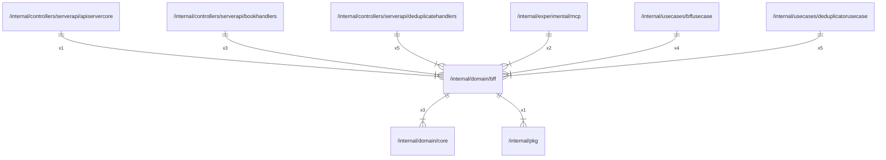

# bff

## Imports

### Inner imports

| Name | Path                             | Count |
|:-----|:---------------------------------|------:|
| core | [/internal/domain/core](core.md) |     3 |
| pkg  | [/internal/pkg](../pkg.md)       |     1 |

### External imports

| Name | Path                   | Count |
|:-----|:-----------------------|------:|
| uuid | github.com/google/uuid |     2 |

### Std imports

| Name | Path | Count |
|:-----|:-----|------:|
| math | math |     1 |

## Used by

| Name                | Path                                                                                                   |
|:--------------------|:-------------------------------------------------------------------------------------------------------|
| apiservercore       | [/internal/controllers/serverapi/apiservercore](../controllers/serverapi/apiservercore.md)             |
| bookhandlers        | [/internal/controllers/serverapi/bookhandlers](../controllers/serverapi/bookhandlers.md)               |
| deduplicatehandlers | [/internal/controllers/serverapi/deduplicatehandlers](../controllers/serverapi/deduplicatehandlers.md) |
| mcp                 | [/internal/experimental/mcp](../experimental/mcp.md)                                                   |
| bffusecase          | [/internal/usecases/bffusecase](../usecases/bffusecase.md)                                             |
| deduplicatorusecase | [/internal/usecases/deduplicatorusecase](../usecases/deduplicatorusecase.md)                           |

## Scheme

---

> Generated by [goArchLint](https://github.com/gbh007/goarchlint)
