# fsmodel

## Imports

### Inner imports

| Name | Path                             | Count |
|:-----|:---------------------------------|------:|
| core | [/internal/domain/core](core.md) |     1 |

### External imports

| Name | Path                   | Count |
|:-----|:-----------------------|------:|
| uuid | github.com/google/uuid |     1 |

### Std imports

| Name | Path    | Count |
|:-----|:--------|------:|
| url  | net/url |     1 |
| time | time    |     1 |

## Used by

| Name              | Path                                                                                               |
|:------------------|:---------------------------------------------------------------------------------------------------|
| agentapi          | [/internal/controllers/agentapi](../controllers/agentapi.md)                                       |
| apiservercore     | [/internal/controllers/serverapi/apiservercore](../controllers/serverapi/apiservercore.md)         |
| fshandlers        | [/internal/controllers/serverapi/fshandlers](../controllers/serverapi/fshandlers.md)               |
| workermanager     | [/internal/controllers/workermanager](../controllers/workermanager.md)                             |
| agentapi          | [/internal/dataproviders/agentapi](../dataproviders/agentapi.md)                                   |
| adapter           | [/internal/dataproviders/agentapi/internal/adapter](../dataproviders/agentapi/internal/adapter.md) |
| agentfs           | [/internal/dataproviders/agentfs](../dataproviders/agentfs.md)                                     |
| filestorage       | [/internal/dataproviders/filestorage](../dataproviders/filestorage.md)                             |
| localfs           | [/internal/dataproviders/localfs](../dataproviders/localfs.md)                                     |
| file              | [/internal/dataproviders/serverdb/internal/file](../dataproviders/serverdb/internal/file.md)       |
| model             | [/internal/dataproviders/serverdb/internal/model](../dataproviders/serverdb/internal/model.md)     |
| other             | [/internal/dataproviders/serverdb/internal/other](../dataproviders/serverdb/internal/other.md)     |
| tmpdata           | [/internal/dataproviders/tmpdata](../dataproviders/tmpdata.md)                                     |
| bffusecase        | [/internal/usecases/bffusecase](../usecases/bffusecase.md)                                         |
| cleanupusecase    | [/internal/usecases/cleanupusecase](../usecases/cleanupusecase.md)                                 |
| filesystemusecase | [/internal/usecases/filesystemusecase](../usecases/filesystemusecase.md)                           |

## Scheme

```mermaid
erDiagram
    "/internal/controllers/agentapi" ||--|{ "/internal/domain/fsmodel" : x2
    "/internal/controllers/serverapi/apiservercore" ||--|{ "/internal/domain/fsmodel" : x1
    "/internal/controllers/serverapi/fshandlers" ||--|{ "/internal/domain/fsmodel" : x4
    "/internal/controllers/workermanager" ||--|{ "/internal/domain/fsmodel" : x1
    "/internal/dataproviders/agentapi" ||--|{ "/internal/domain/fsmodel" : x1
    "/internal/dataproviders/agentapi/internal/adapter" ||--|{ "/internal/domain/fsmodel" : x1
    "/internal/dataproviders/agentfs" ||--|{ "/internal/domain/fsmodel" : x1
    "/internal/dataproviders/filestorage" ||--|{ "/internal/domain/fsmodel" : x4
    "/internal/dataproviders/localfs" ||--|{ "/internal/domain/fsmodel" : x1
    "/internal/dataproviders/serverdb/internal/file" ||--|{ "/internal/domain/fsmodel" : x5
    "/internal/dataproviders/serverdb/internal/model" ||--|{ "/internal/domain/fsmodel" : x1
    "/internal/dataproviders/serverdb/internal/other" ||--|{ "/internal/domain/fsmodel" : x1
    "/internal/dataproviders/tmpdata" ||--|{ "/internal/domain/fsmodel" : x2
    "/internal/domain/fsmodel" ||--|{ "/internal/domain/core" : x1
    "/internal/usecases/bffusecase" ||--|{ "/internal/domain/fsmodel" : x1
    "/internal/usecases/cleanupusecase" ||--|{ "/internal/domain/fsmodel" : x3
    "/internal/usecases/filesystemusecase" ||--|{ "/internal/domain/fsmodel" : x4
```

---

> Generated by [goArchLint](https://github.com/gbh007/goarchlint)
