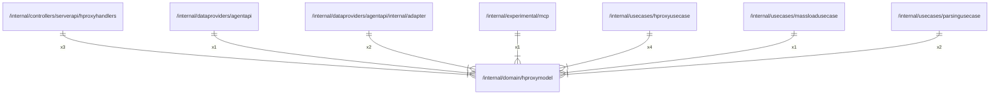

# hproxymodel

## Imports

### External imports

| Name | Path                   | Count |
|:-----|:-----------------------|------:|
| uuid | github.com/google/uuid |     1 |
| lo   | github.com/samber/lo   |     1 |

### Std imports

| Name | Path    | Count |
|:-----|:--------|------:|
| url  | net/url |     1 |

## Used by

| Name            | Path                                                                                               |
|:----------------|:---------------------------------------------------------------------------------------------------|
| hproxyhandlers  | [/internal/controllers/serverapi/hproxyhandlers](../controllers/serverapi/hproxyhandlers.md)       |
| agentapi        | [/internal/dataproviders/agentapi](../dataproviders/agentapi.md)                                   |
| adapter         | [/internal/dataproviders/agentapi/internal/adapter](../dataproviders/agentapi/internal/adapter.md) |
| mcp             | [/internal/experimental/mcp](../experimental/mcp.md)                                               |
| hproxyusecase   | [/internal/usecases/hproxyusecase](../usecases/hproxyusecase.md)                                   |
| massloadusecase | [/internal/usecases/massloadusecase](../usecases/massloadusecase.md)                               |
| parsingusecase  | [/internal/usecases/parsingusecase](../usecases/parsingusecase.md)                                 |

## Scheme

---

> Generated by [goArchLint](https://github.com/gbh007/goarchlint)
