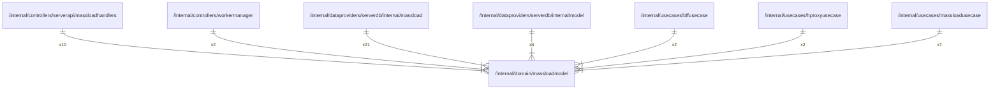

# massloadmodel

## Imports

### Std imports

| Name | Path    | Count |
|:-----|:--------|------:|
| url  | net/url |     1 |
| time | time    |     1 |

## Used by

| Name             | Path                                                                                                 |
|:-----------------|:-----------------------------------------------------------------------------------------------------|
| massloadhandlers | [/internal/controllers/serverapi/massloadhandlers](../controllers/serverapi/massloadhandlers.md)     |
| workermanager    | [/internal/controllers/workermanager](../controllers/workermanager.md)                               |
| massload         | [/internal/dataproviders/serverdb/internal/massload](../dataproviders/serverdb/internal/massload.md) |
| model            | [/internal/dataproviders/serverdb/internal/model](../dataproviders/serverdb/internal/model.md)       |
| bffusecase       | [/internal/usecases/bffusecase](../usecases/bffusecase.md)                                           |
| hproxyusecase    | [/internal/usecases/hproxyusecase](../usecases/hproxyusecase.md)                                     |
| massloadusecase  | [/internal/usecases/massloadusecase](../usecases/massloadusecase.md)                                 |

## Scheme

---

> Generated by [goArchLint](https://github.com/gbh007/goarchlint)
