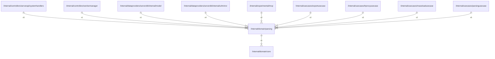

# parsing

## Imports

### Inner imports

| Name | Path                             | Count |
|:-----|:---------------------------------|------:|
| core | [/internal/domain/core](core.md) |     1 |

### External imports

| Name | Path                   | Count |
|:-----|:-----------------------|------:|
| uuid | github.com/google/uuid |     4 |

### Std imports

| Name    | Path    | Count |
|:--------|:--------|------:|
| url     | net/url |     3 |
| fmt     | fmt     |     1 |
| strings | strings |     1 |

## Used by

| Name            | Path                                                                                                   |
|:----------------|:-------------------------------------------------------------------------------------------------------|
| systemhandlers  | [/internal/controllers/serverapi/systemhandlers](../controllers/serverapi/systemhandlers.md)           |
| workermanager   | [/internal/controllers/workermanager](../controllers/workermanager.md)                                 |
| model           | [/internal/dataproviders/serverdb/internal/model](../dataproviders/serverdb/internal/model.md)         |
| urlmirror       | [/internal/dataproviders/serverdb/internal/urlmirror](../dataproviders/serverdb/internal/urlmirror.md) |
| mcp             | [/internal/experimental/mcp](../experimental/mcp.md)                                                   |
| exportusecase   | [/internal/usecases/exportusecase](../usecases/exportusecase.md)                                       |
| hproxyusecase   | [/internal/usecases/hproxyusecase](../usecases/hproxyusecase.md)                                       |
| massloadusecase | [/internal/usecases/massloadusecase](../usecases/massloadusecase.md)                                   |
| parsingusecase  | [/internal/usecases/parsingusecase](../usecases/parsingusecase.md)                                     |

## Scheme

---

> Generated by [goArchLint](https://github.com/gbh007/goarchlint)
