# serveragentdto

## Imports

### Inner imports

| Name | Path                             | Count |
|:-----|:---------------------------------|------:|
| core | [/internal/domain/core](core.md) |     2 |

### External imports

| Name | Path                   | Count |
|:-----|:-----------------------|------:|
| uuid | github.com/google/uuid |     2 |

### Std imports

| Name    | Path            | Count |
|:--------|:----------------|------:|
| errors  | errors          |     2 |
| time    | time            |     2 |
| bytes   | bytes           |     1 |
| md5     | crypto/md5      |     1 |
| base64  | encoding/base64 |     1 |
| binary  | encoding/binary |     1 |
| fmt     | fmt             |     1 |
| io      | io              |     1 |
| url     | net/url         |     1 |
| slices  | slices          |     1 |
| testing | testing         |     1 |

## Used by

| Name            | Path                                                                                               |
|:----------------|:---------------------------------------------------------------------------------------------------|
| agent           | [/internal/application/agent](../application/agent.md)                                             |
| agentapi        | [/internal/controllers/agentapi](../controllers/agentapi.md)                                       |
| agentcacheapi   | [/internal/controllers/agentcacheapi](../controllers/agentcacheapi.md)                             |
| agenthandlers   | [/internal/controllers/serverapi/agenthandlers](../controllers/serverapi/agenthandlers.md)         |
| workermanager   | [/internal/controllers/workermanager](../controllers/workermanager.md)                             |
| agentapi        | [/internal/dataproviders/agentapi](../dataproviders/agentapi.md)                                   |
| adapter         | [/internal/dataproviders/agentapi/internal/adapter](../dataproviders/agentapi/internal/adapter.md) |
| masterapi       | [/internal/dataproviders/masterapi](../dataproviders/masterapi.md)                                 |
| tmpdata         | [/internal/dataproviders/tmpdata](../dataproviders/tmpdata.md)                                     |
| agentmanagesuc  | [/internal/usecases/agentmanagesuc](../usecases/agentmanagesuc.md)                                 |
| agentparseruc   | [/internal/usecases/agentparseruc](../usecases/agentparseruc.md)                                   |
| exportusecase   | [/internal/usecases/exportusecase](../usecases/exportusecase.md)                                   |
| hproxyusecase   | [/internal/usecases/hproxyusecase](../usecases/hproxyusecase.md)                                   |
| massloadusecase | [/internal/usecases/massloadusecase](../usecases/massloadusecase.md)                               |
| parsingusecase  | [/internal/usecases/parsingusecase](../usecases/parsingusecase.md)                                 |

## Scheme

```mermaid
erDiagram
    "/internal/application/agent" ||--|{ "/internal/domain/serveragentdto" : x1
    "/internal/controllers/agentapi" ||--|{ "/internal/domain/serveragentdto" : x2
    "/internal/controllers/agentcacheapi" ||--|{ "/internal/domain/serveragentdto" : x2
    "/internal/controllers/serverapi/agenthandlers" ||--|{ "/internal/domain/serveragentdto" : x2
    "/internal/controllers/workermanager" ||--|{ "/internal/domain/serveragentdto" : x2
    "/internal/dataproviders/agentapi" ||--|{ "/internal/domain/serveragentdto" : x1
    "/internal/dataproviders/agentapi/internal/adapter" ||--|{ "/internal/domain/serveragentdto" : x6
    "/internal/dataproviders/masterapi" ||--|{ "/internal/domain/serveragentdto" : x1
    "/internal/dataproviders/tmpdata" ||--|{ "/internal/domain/serveragentdto" : x2
    "/internal/domain/serveragentdto" ||--|{ "/internal/domain/core" : x2
    "/internal/usecases/agentmanagesuc" ||--|{ "/internal/domain/serveragentdto" : x2
    "/internal/usecases/agentparseruc" ||--|{ "/internal/domain/serveragentdto" : x1
    "/internal/usecases/exportusecase" ||--|{ "/internal/domain/serveragentdto" : x2
    "/internal/usecases/hproxyusecase" ||--|{ "/internal/domain/serveragentdto" : x4
    "/internal/usecases/massloadusecase" ||--|{ "/internal/domain/serveragentdto" : x2
    "/internal/usecases/parsingusecase" ||--|{ "/internal/domain/serveragentdto" : x7
```

---

> Generated by [goArchLint](https://github.com/gbh007/goarchlint)
